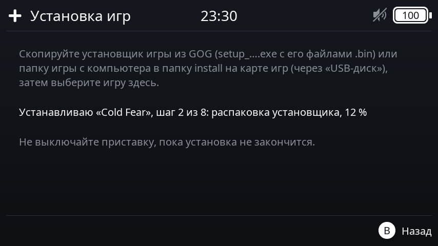
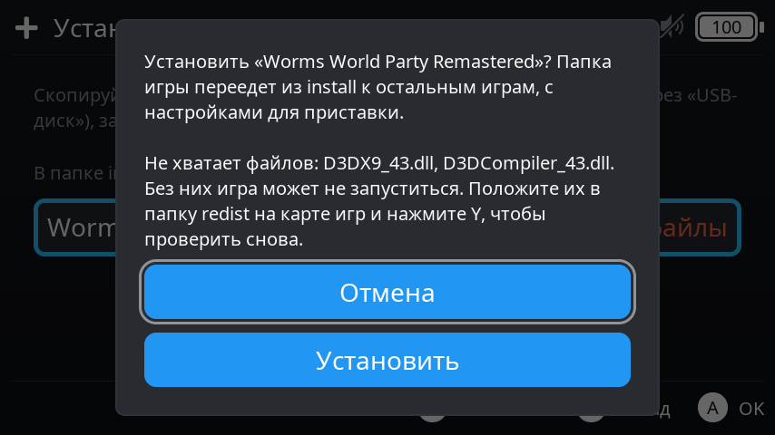

# Установка игр

На ODROID-GO Ultra игры ставятся прямо с карты игр. Скопируйте на карту установщик игры
из GOG (или папку уже установленной игры), затем выберите игру на приставке. Приставка
сама распакует установщик, узнает игру и настроит её. Управление, разрешение, обложка и
перевод для знакомых ей игр уже подобраны.

Компьютер нужен только для того, чтобы скачать игру и скопировать её на карту.
Устанавливать игру на компьютер не нужно.

## Какие игры можно поставить

**Игры, которые приставка знает.** Для них всё подобрано и проверено:

| | |
|---|---|
| Call of Duty 2 | Prince of Persia: The Sands of Time |
| Cold Fear | Return to Castle Wolfenstein |
| Daemonica | Serious Sam: The First Encounter |
| DOOM 3 BFG Edition | Serious Sam: The Second Encounter |
| Fallout, Fallout 2 | Shade: Wrath of Angels |
| GUN | Sid Meier's Pirates! |
| Half-Life (из Steam) | Swashbucklers: Blue vs. Grey |
| Heroes of Might and Magic III | Heroes III: Horn of the Abyss |
| Knights of the Temple | Syberia |
| Need for Speed: Underground | Tales of Monkey Island (все пять глав) |
| Need for Speed: Most Wanted | The Bard's Tale |
| Neighbours from Hell 1 и 2 | The Book of Unwritten Tales |
| Корсары: Пираты Карибского моря | Worms World Party Remastered |

Приставка узнаёт игру по её главным файлам, а не по точной версии. Поэтому подойдёт и
издание GOG, и диск, и другая версия той же игры. Настройки проверялись на одном
издании: с другим игра может вести себя немного иначе. Если она не запустится, смотрите
главу [«Если игра не работает»](20-problems.md).

**Другие игры для Windows.** Их тоже можно поставить, но готовых настроек для них нет
(подробнее — в разделе «Неизвестные игры» ниже). Такая игра может не заработать вовсе.

Про Героев III и Half-Life есть отдельный раздел ниже.

## Что копировать

Есть два способа, подойдёт любой.

**Установщик из GOG (проще всего).** В своём аккаунте на сайте GOG откройте игру и
скачайте «автономный установщик» (offline backup installer). Это файл
`setup_….exe`. У больших игр к нему прилагаются один или несколько файлов
`setup_…-1.bin`, `setup_…-2.bin`. Нужны все эти файлы, как они скачались. Ничего
запускать на компьютере не нужно.

**Папка уже установленной игры.** Если игра уже стоит на компьютере, можно скопировать
её папку целиком, например `C:\GOG Games\Fallout 2` или
`...\steamapps\common\Call of Duty 2`. Игру с диска сначала установите на компьютер,
потом скопируйте её папку.

Установщики других магазинов приставка не распаковывает: такую игру установите на
компьютер и скопируйте папку.

## Как скопировать на карту

1. На главном экране выберите круглую кнопку «USB-диск» (первая под плитками) и
   подключите приставку кабелем к компьютеру. Карта игр появится как обычный диск.
2. Откройте на ней папку `install` и скопируйте туда установщик (все его файлы) или
   папку игры. Можно сразу несколько игр. Приставка сама создаёт эту папку и кладёт в
   неё памятку «КАК УСТАНОВИТЬ ИГРУ.txt», а в корень карты — это руководство
   («Руководство.html»).
3. Извлеките диск на компьютере и нажмите B на приставке.

Можно и просто вынуть карту и вставить её в картридер.

Сколько места нужно: папка игры при установке не копируется ещё раз, а переезжает на
своё место, поэтому ей нужно столько, сколько она занимает. Установщику нужно место и
для него самого, и для распакованной игры. Сколько именно, приставка скажет перед
установкой. После установки файлы установщика с карты удаляются.

## Установка

На главном экране выберите круглую кнопку «+» (вторая под плитками): откроется экран
«Установка игр» со всем, что лежит в папке `install`.

| Справа от названия | Что это значит |
|---|---|
| установить | приставка знает эту игру, её ещё нет на карте |
| уже есть | эта игра уже установлена; если выбрать её, приставка поставит её заново |
| нужны файлы | приставка знает игру, но ей не хватает файлов Windows (см. «Файлы Windows» ниже) |
| неизвестная | готовых настроек для этой игры нет (см. «Неизвестные игры» ниже) |
| не поддерживается | это установщик, который приставка не распаковывает |

Выберите игру и нажмите A. Приставка спросит подтверждение и скажет, сколько места
нужно. Кнопка «Отмена» выбрана сразу, чтобы установить, нажмите крестовину вниз (на
«Установить») и A.

Папка игры встаёт за несколько секунд, установщик распаковывается дольше: Cold Fear
(1,7 ГБ) — около четырёх минут. На экране видно, какой шаг идёт, и сколько процентов
уже распаковано. Не выключайте приставку, пока установка не закончится. С экрана можно
уйти (B), установка продолжится.

Когда всё готово, экран напишет «Игра … установлена и появилась на главном экране».
Установщик или папка игры исчезнут из `install`. Новая игра встаёт после тех, в которые
уже играли. Если игр больше десяти, её плитка будет в «Все игры» (последняя плитка в
ряду).

Если игра «уже есть», приставка ставит её заново: старая папка игры на карте заменяется
новой. Сохранения и настройки игры лежат в памяти приставки и остаются как были.

Если вы скопировали ещё одну игру, пока экран открыт, нажмите **Y**: экран заново
посмотрит, что лежит в папке `install`. **X** удаляет выбранную запись из папки
`install` (после вопроса). Установленные игры это не затрагивает.

## Файлы Windows (папка redist)

Некоторым играм нужны файлы Windows, которых нет в самой игре: библиотеки DirectX,
звуковая библиотека OpenAL, шрифты. На экране у таких игр написано «нужны файлы», а
перед установкой приставка перечислит, каких именно не хватает.

**DirectX** (`D3DX9_….dll`, `D3DCompiler_43.dll`) обычно ничего делать не нужно.
Установщики GOG содержат DirectX, и приставка, поставив игру из такого установщика,
оставляет его на карте в папке `redist/DirectX` для других игр. Если вы ещё не ставили
ни одной игры из установщика GOG, скачайте у Microsoft пакет «DirectX End-User Runtimes
(June 2010)». Это один файл `directx_Jun2010_redist.exe`, его нужно положить в папку
`redist` на карте как есть, распаковывать не нужно. Затем на экране установки нажмите
**Y**: надпись «нужны файлы» сменится на «установить».

| Игра | Что ей нужно |
|---|---|
| Tales of Monkey Island | DirectX (`D3DX9_41.dll`) |
| The Book of Unwritten Tales | DirectX (`d3dx9_42.dll`) |
| Worms World Party Remastered | DirectX (`D3DX9_43.dll`, `D3DCompiler_43.dll`) |
| Daemonica | `OpenAL32.dll`, `wrap_oal.dll`, шрифты `arial*.ttf`, `pala*.ttf`, `Meatcm__.ttf` |
| Prince of Persia: The Sands of Time | `pop1_rus_full.exe`, русификатор (без него игра будет на английском) |

Остальные файлы кладут в папку `redist` на карте игр (рядом с `install`). Подпапки
внутри неё можно делать любые, регистр букв в имени файла не важен. Где их взять:

- **`OpenAL32.dll`, `wrap_oal.dll`.** Их ставит установщик самой Daemonica или
  установщик OpenAL от Creative (`oalinst.exe`, он есть у многих игр). Файлы лежат в
  `C:\Windows\SysWOW64` (на 32-битной Windows — в `C:\Windows\System32`).
- **Шрифты** (`arial…`, `pala…`, `Meatcm__.ttf`) лежат в `C:\Windows\Fonts`. Arial и
  Palatino есть в любой Windows, `Meatcm__.ttf` туда кладёт установщик Daemonica.
- **Отдельные DLL.** Если копируете DLL из Windows, а не из пакета DirectX, нужны
  32-битные: на 64-битной Windows они лежат в `C:\Windows\SysWOW64`. Файлы из
  `C:\Windows\System32` 64-битной Windows не подойдут: приставка их не возьмёт.

Можно поставить игру и без этих файлов: приставка предупредит, каких не хватило. Такая
игра может не запуститься и показать экран ошибки «Игре нужна библиотека Windows …».
Чтобы добавить файлы потом, положите их в `redist`, снова скопируйте игру в `install` и
поставьте её заново («уже есть»). Сохранения при этом не пропадут.

## Герои III и Half-Life

**Heroes of Might and Magic III** (например, Complete из GOG) ставится в версии для
VCMI: это заново написанный движок игры, он работает на приставке напрямую, без
Windows.
Если в папке игры уже стоит дополнение Horn of the Abyss (есть файл `h3hota HD.exe`),
игра встанет как «Heroes III: Horn of the Abyss» в своём оригинальном виде.

Для VCMI есть два дополнения, которые стоит положить в папку `redist` на карте до
установки (как есть, распаковывать не нужно):

- **Horn of the Abyss** для VCMI: `horn-of-the-abyss-vcmi-1.7.zip`, страница
  github.com/vcmi-mods/horn-of-the-abyss, раздел Releases, версия 1.7;
- **русский перевод**: `mega-pack-rus-vcmi-1.7.zip`, страница
  github.com/vcmi-mods/mega-pack-rus, раздел Releases, версия 1.7.

Без них игра тоже встанет и будет работать, только без дополнения и на языке самой
игры. Если Герои III уже стоят на карте с дополнениями, при переустановке они
сохранятся.

**Half-Life** ставится из Steam: скопируйте в `install` папку игры из Steam
(`...\steamapps\common\Half-Life`) целиком. Игра работает на своём движке приставки,
из папки берутся только файлы игры.

## Неизвестные игры

Если приставка не знает игру, нажатие A покажет программы (`.exe`) игры. Первой стоит
та, что больше всего похожа на саму игру. У игр GOG это та программа, которую запускает
сам GOG. Выберите программу, которая запускает игру, и подтвердите.

Игра ставится как Windows-игра с настройками по умолчанию:

| Кнопка | Что делает |
|---|---|
| левый стик | курсор мыши |
| правый стик | колесо мыши |
| A / Y | левый / правый щелчок мыши |
| B | Esc |
| X | Enter |
| крестовина | стрелки |
| L1 / R1 | Page Up / Page Down |
| L2 / R2 | Shift / Ctrl |
| F1–F4 | F1–F4 |

Управление можно поменять на экране управления игры (X на её плитке). Папка игры на
карте получит латинское имя по имени игры, например «Сапёр» станет `saper`.

## Если установка не удалась

Экран напишет «Не удалось установить игру» и причину:

| Причина | Что делать |
|---|---|
| её папки или программы больше нет в папке install | папку переименовали или удалили, пока экран был открыт: нажмите Y |
| установщик не удалось распаковать | скопируйте установщик заново, вместе со всеми его файлами `.bin` |
| на карте уже есть папка … | так называется папка другой игры или старой копии этой: удалите лишнюю или переименуйте папку в `install` |
| на карте игр не хватает места | удалите ненужные игры (Y на плитке → «Удалить игру») |
| на карту игр не удаётся записать | карта может быть повреждена: проверьте её на компьютере |

Если после установки написано «Подготовка игры для приставки прошла не до конца»,
игра поставлена, но её настройка завершилась не полностью. Запустите игру. Если она
работает плохо, сохраните отчёт (глава [«Если игра не работает»](20-problems.md)).
