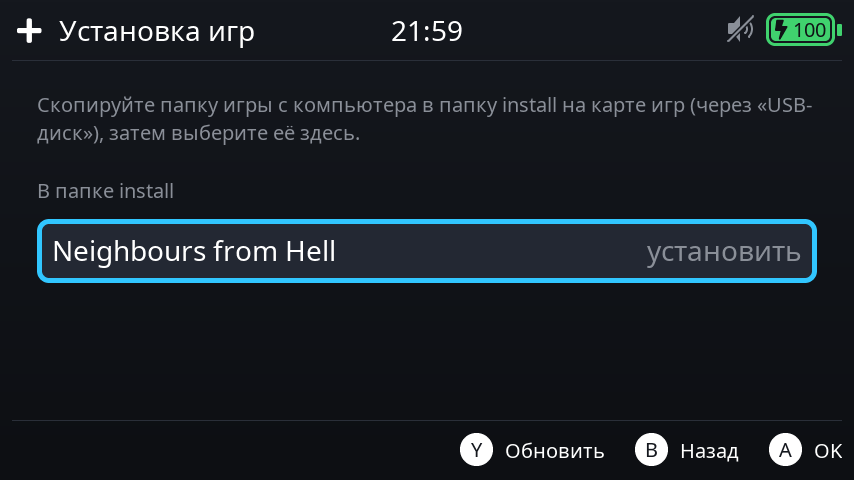
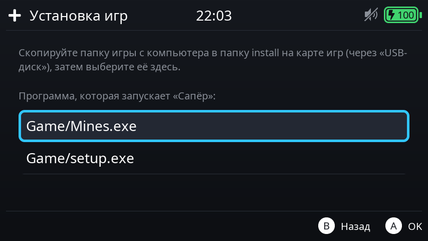

# Установка игр

На ODROID-GO Ultra игры ставятся прямо с карты игр. Скопируйте папку игры с компьютера
в папку `install` на карте, затем выберите игру на приставке. Приставка сама узнает
игру, перенесёт её к остальным играм и настроит. Управление, разрешение, обложка и
перевод для знакомых ей игр уже подобраны.

Компьютер нужен только для того, чтобы скопировать папку. Ставить игру на компьютер
перед этим нужно, только если она пришла в виде установщика (об этом ниже).

## Какие игры можно поставить

**Игры, которые приставка знает.** Для них всё подобрано и проверено:

| | |
|---|---|
| Call of Duty 2 | Prince of Persia: The Sands of Time |
| Cold Fear | Return to Castle Wolfenstein |
| Daemonica | Serious Sam: The First Encounter |
| DOOM 3 BFG Edition | Serious Sam: The Second Encounter |
| Fallout, Fallout 2 | Shade: Wrath of Angels |
| GUN | Sid Meier's Pirates! |
| Heroes III: Horn of the Abyss | Swashbucklers: Blue vs. Grey |
| Knights of the Temple | Syberia |
| Need for Speed: Underground | Tales of Monkey Island (все пять глав) |
| Need for Speed: Most Wanted | The Bard's Tale |
| Neighbours from Hell 1 и 2 | The Book of Unwritten Tales |
| Корсары: Пираты Карибского моря | Worms World Party Remastered |

Приставка узнаёт игру по её главным файлам, а не по точной версии. Поэтому подойдёт и
издание GOG, и диск, и другая версия той же игры. Настройки проверялись на одном
издании: с другим игра может вести себя немного иначе. Если она не запустится, смотрите
главу [«Если игра не работает»](20-problems.md).

**Другие игры для Windows.** Их тоже можно поставить, но готовых настроек для них нет
(подробнее — в разделе «Неизвестные игры» ниже). Такая игра может не заработать вовсе.

Герои III в версии для VCMI и Half-Life этим экраном пока не ставятся.

## Что копировать

Нужна папка **уже установленной** игры, в которой лежит её программа (`.exe`):

- игра из GOG Galaxy или Steam — её папка на компьютере, например
  `C:\GOG Games\Fallout 2` или `...\steamapps\common\Call of Duty 2`;
- игра с диска — папка, куда её установил установщик с диска.

Установщики (`setup_....exe`) на приставке не запускаются. Сначала установите игру на
компьютер с Windows, потом скопируйте получившуюся папку.

## Как скопировать на карту

1. На главном экране выберите круглую кнопку «USB-диск» (первая под плитками) и
   подключите приставку кабелем к компьютеру. Карта игр появится как обычный диск.
2. Создайте на ней папку `install`, если её нет, и скопируйте туда папку игры целиком.
   Можно сразу несколько игр.
3. Извлеките диск на компьютере и нажмите B на приставке.

Можно и просто вынуть карту и вставить её в картридер.

Места на карте нужно столько, сколько занимает сама игра: при установке папка не
копируется ещё раз, а переезжает на своё место.

## Установка

На главном экране выберите круглую кнопку «+» (вторая под плитками): откроется экран
«Установка игр» со всем, что лежит в папке `install`.

| Справа от названия | Что это значит |
|---|---|
| установить | приставка знает эту игру, её ещё нет на карте |
| уже есть | эта игра уже установлена; если выбрать её, приставка поставит её заново |
| нужны файлы | приставка знает игру, но ей нужны файлы с компьютера (см. «Файлы с компьютера» ниже) |
| неизвестная | готовых настроек для этой игры нет (см. «Неизвестные игры» ниже) |
| установщик | это установщик, на приставке он не запускается |

Выберите игру и нажмите A. Приставка спросит подтверждение: кнопка «Отмена» выбрана
сразу, чтобы установить, нажмите крестовину вниз (на «Установить») и A.

Установка занимает от нескольких секунд до пары минут. На экране видно, какой шаг
идёт. Не выключайте приставку, пока установка не закончится. С экрана можно уйти (B),
установка продолжится.

Когда всё готово, экран напишет «Игра … установлена и появилась на главном экране».
Папка игры исчезнет из `install`. Новая игра встаёт после тех, в которые уже играли.
Если игр больше десяти, её плитка будет в «Все игры» (последняя плитка в ряду).

Если игра «уже есть», приставка ставит её заново: старая папка игры на карте заменяется
новой. Сохранения и настройки игры лежат в памяти приставки и остаются как были.

Если вы скопировали ещё одну игру, пока экран открыт, нажмите **Y**: экран заново
посмотрит, что лежит в папке `install`.

## Файлы с компьютера (папка redist)

Некоторым играм нужны файлы Windows, которых нет в папке самой игры: библиотеки
DirectX, звуковая библиотека OpenAL, шрифты. На экране у таких игр написано «нужны
файлы», а перед установкой приставка перечислит, каких именно не хватает.

Положите эти файлы в папку `redist` на карте игр (создайте её рядом с `install`).
Подпапки внутри `redist` можно делать любые, а регистр букв в имени файла не важен.
Затем нажмите **Y**: если всё нашлось, надпись «нужны файлы» сменится на «установить».

| Игра | Файлы |
|---|---|
| Tales of Monkey Island | `D3DX9_41.dll` |
| The Book of Unwritten Tales | `d3dx9_42.dll`, `soft_oal.dll` |
| Worms World Party Remastered | `D3DX9_43.dll`, `D3DCompiler_43.dll` |
| Daemonica | `OpenAL32.dll`, `wrap_oal.dll`, шрифты `arial*.ttf`, `pala*.ttf`, `Meatcm__.ttf` |
| Prince of Persia: The Sands of Time | `pop1_rus_full.exe`, русификатор (без него игра будет на английском) |

Где их взять:

- **`D3DX9_….dll`, `D3DCompiler_43.dll`** (DirectX 9). Это части DirectX, которые
  почти все старые игры ставят в Windows сами. На компьютере с 64-битной Windows они
  лежат в `C:\Windows\SysWOW64`, с 32-битной — в `C:\Windows\System32`. Если их там
  нет, скачайте у Microsoft пакет «DirectX End-User Runtimes (June 2010)» и распакуйте
  его. Нужные файлы лежат внутри архивов `.cab` с `x86` в имени (например
  `Jun2010_d3dx9_43_x86.cab`), такие архивы открывает 7-Zip. Нужны именно 32-битные
  файлы (x86). Файлы из `C:\Windows\System32` 64-битной Windows не подойдут: приставка
  их не возьмёт.
- **`OpenAL32.dll`, `wrap_oal.dll`.** Их ставит установщик самой Daemonica или
  установщик OpenAL от Creative (`oalinst.exe`, он есть у многих игр). Файлы лежат в
  `C:\Windows\SysWOW64` (на 32-битной Windows — в `C:\Windows\System32`).
- **`soft_oal.dll`.** Это OpenAL Soft: в архиве `openal-soft-1.23.1-bin.zip` с сайта
  openal-soft.org нужен файл `bin\Win32\soft_oal.dll`.
- **Шрифты** (`arial…`, `pala…`, `Meatcm__.ttf`) лежат в `C:\Windows\Fonts`. Arial и
  Palatino есть в любой Windows, `Meatcm__.ttf` туда кладёт установщик Daemonica.

Можно поставить игру и без этих файлов: приставка предупредит, каких не хватило. Такая
игра может не запуститься и показать экран ошибки «Игре нужна библиотека Windows …».
Чтобы добавить файлы потом, положите их в `redist`, снова скопируйте папку игры в
`install` и поставьте её заново («уже есть»). Сохранения при этом не пропадут.

## Неизвестные игры

Если приставка не знает игру, нажатие A покажет программы (`.exe`) из её папки.
Первой стоит та, что больше всего похожа на саму игру: не установщик, не настройка и
не программа удаления. Выберите программу, которая запускает игру, и подтвердите.

Игра ставится как Windows-игра с настройками по умолчанию:

| Кнопка | Что делает |
|---|---|
| левый стик | курсор мыши |
| правый стик | колесо мыши |
| A / Y | левый / правый щелчок мыши |
| B | Esc |
| X | Enter |
| крестовина | стрелки |
| L1 / R1 | Page Up / Page Down |
| L2 / R2 | Shift / Ctrl |
| F1–F4 | F1–F4 |

Управление можно поменять на экране управления игры (X на её плитке). Папка игры на
карте получит латинское имя по имени скопированной папки, например «Сапёр» станет
`saper`.

## Если установка не удалась

Экран напишет «Не удалось установить игру» и причину:

| Причина | Что делать |
|---|---|
| её папки или программы больше нет в папке install | папку переименовали или удалили, пока экран был открыт: нажмите Y |
| на карте уже есть папка … | так называется папка другой игры или старой копии этой: удалите лишнюю или переименуйте папку в `install` |
| на карте игр не хватает места | удалите ненужные игры (Y на плитке → «Удалить игру») |
| на карту игр не удаётся записать | карта может быть повреждена: проверьте её на компьютере |

Если после установки написано «Подготовка игры для приставки прошла не до конца»,
игра поставлена, но её настройка завершилась не полностью. Запустите игру. Если она
работает плохо, сохраните отчёт (глава [«Если игра не работает»](20-problems.md)).
