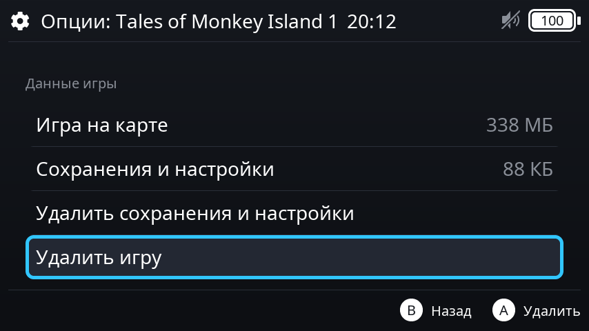

# Игры: опции и удаление

## Опции игры

На главном экране выберите плитку игры и нажмите **Y**: откроются опции этой игры.

**Предел кадров.** Сколько кадров в секунду игра показывает самое большее. Чем меньше,
тем ровнее идёт игра, меньше греется приставка и медленнее садится батарея. Для каждой
игры уже выбрано подходящее значение (оно написано под строкой). Крестовина
влево-вправо меняет предел, X возвращает рекомендуемый. Изменение действует сразу, даже
если игра свёрнута.

**Данные игры.** Сколько места занимает игра:

| Строка | Что это |
|---|---|
| Игра на карте | файлы самой игры на карте игр |
| Сохранения и настройки | сохранённые игры и настройки игры в памяти приставки |

Размеры считаются при открытии экрана, у больших игр это занимает несколько секунд
(«считаю...»).

## Удалить игру

«Удалить игру» стирает файлы игры с карты, чтобы освободить место. Перед удалением
приставка спросит подтверждение и скажет, сколько места освободится. Кнопка «Отмена»
выбрана сразу. Чтобы удалить, нажмите крестовину вниз (на «Удалить») и A.

После удаления приставка вернётся на главный экран, плитки игры там уже не будет.

**Сохранения при этом остаются** в памяти приставки. Если потом вернуть игру на карту,
она продолжится с того же места.

Чтобы вернуть игру, скопируйте её папку с компьютера в папку `install` на карте игр и
поставьте её на экране «Установка игр» (глава [«Установка игр»](05-install.md)).
Приставка снова настроит её сама.

У игр, встроенных в систему (например, Doom), файлов на карте нет, и строки «Удалить
игру» у них нет.

## Удалить сохранения и настройки

«Удалить сохранения и настройки» стирает сохранённые игры и настройки этой игры. При
следующем запуске игра начнётся заново, как в первый раз. Перед удалением приставка
спросит подтверждение и покажет, какие папки будут удалены. Удаление необратимо:
если сохранения нужны, сначала скопируйте их на компьютер.

Если игра сейчас свёрнута, в вопросе будет написано «Свёрнутая игра будет закрыта»:
перед удалением приставка её закроет. Несохранённый прогресс в ней пропадёт.

Настройки самой приставки для этой игры (предел кадров, управление) при этом не
сбрасываются. Управление сбрасывается на экране управления игры (X на плитке).
