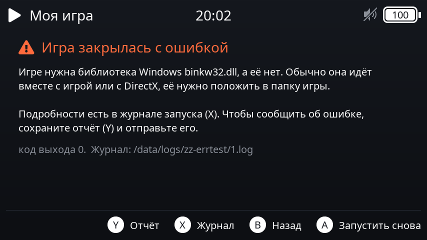

# Если игра не работает

## Экран ошибки

Если игра закрылась из-за ошибки или не смогла запуститься, вместо возврата на главный
экран приставка показывает экран ошибки:



- **Заголовок.** «Игра закрылась с ошибкой», если игра успела запуститься, или «Игра
  не запустилась».
- **Что случилось и что делать.** Если приставка узнала ошибку, она объясняет её
  обычными словами. Если нет, пишет, как игра закончилась: «Игра упала (сигнал 11)»
  или «Игра закрылась с кодом ошибки 3».
- **Мелкая строка внизу**: технические подробности (код выхода или номер сигнала) и
  путь к журналу этого запуска.

Кнопки:

| Кнопка | Что делает |
|---|---|
| A | запускает игру снова |
| X | показывает конец журнала запуска; крестовина листает его, X или B возвращают описание |
| Y | сохраняет отчёт об ошибке (см. ниже «Отчёт об ошибке») |
| B | возвращает на главный экран |

Если вы сами закрыли игру (удержанием F6, через быстрое меню или через выход в меню
самой игры), экран ошибки не появляется.

### Какие ошибки приставка узнаёт

| Что вы увидите | Что произошло | Что делать |
|---|---|---|
| «Приставке не хватило памяти, и система остановила игру» | игре не хватило оперативной памяти | уменьшить в игре разрешение или качество графики; закрыть свёрнутую игру |
| «Игре нужна библиотека Windows …, а её нет» | в папке игры не хватает DLL-файла | положить этот файл в папку игры на карте (он есть в папке игры на компьютере или в DirectX) |
| «Wine в этот момент обновлял свои настройки…» | первый запуск Windows-игры после обновления системы | запустить игру ещё раз |
| «Wine не нашёл программу игры …» / «Нет файла, нужного игре» | на карте нет файла игры | скопировать игру на карту целиком |
| «Wine не смог запустить программу игры» | exe-файл повреждён или это не Windows-программа | скопировать игру заново |
| «Игра упала: ошибка внутри самой Windows-программы» | Windows-игра упала внутри Wine | запустить ещё раз; если повторяется, сохранить отчёт |
| «Игра упала: ошибка внутри движка игры» | упал движок (например, Half-Life) | то же |
| «Память приставки заполнена…» | на `/data` нет места | удалить ненужное, например старые сохранения |
| «Игра пыталась записать файл в свою папку на карте игр…» | ошибка настройки игры | сохранить отчёт и отправить его |
| «Box64… встретил команду процессора, которую пока не умеет выполнять» | эмулятор x86 не справился с кодом игры | игра на приставке пока не работает |
| «Видеоядро сообщило об ошибке во время игры» | сбой графического процессора | запустить ещё раз; если повторяется, сохранить отчёт |

## Отчёт об ошибке

Чтобы сообщить об ошибке, сохраните отчёт. Это один текстовый файл, в котором есть всё,
что нужно для разбора: версия системы, состояние приставки (память, место на дисках,
батарея, температура, запущенные программы), настройки, журналы bare_app и системы и,
главное, журналы запуска игры и её файл настроек.

Сохранить отчёт можно двумя способами:

- **с экрана ошибки** кнопкой Y: в отчёт попадут журналы этой игры;
- **в любой момент**: Настройки → Система → «Сохранить отчёт». В него попадут журналы
  игры, которую запускали последней. Так удобно, если игра не упала, а повела себя
  странно: сначала закройте её, потом сохраните отчёт.

Через мгновение внизу экрана появится сообщение, куда сохранён файл. Отчёт ложится на
карту игр в папку `reports`. Имя файла — дата, время и папка игры:

```
reports/2026-11-23_19-58-02-fallout.txt
```

Если карты игр сейчас нет (вынута или открыта компьютеру как USB-диск), отчёт
сохраняется в память приставки, в `/data/reports`, и сообщение говорит об этом.

**Как забрать отчёт на компьютер.** На главном экране выберите круглую кнопку
«USB-диск» (первая под плитками) и подключите приставку кабелем к компьютеру: карта игр
появится как обычный диск, отчёт лежит в папке `reports`. Можно и просто вынуть карту и
вставить её в картридер. Приложите файл к сообщению об ошибке вместе с коротким
описанием: что делали и что произошло.

**Чего в отчёте нет.** Паролей Wi-Fi, ключей Bluetooth и SSH в отчёт не попадает. Есть
модель и имя приставки, список подключённых USB-устройств, настройки bare_app и список
файлов в папке игры.

## Журнал запуска

Каждый раз, когда вы запускаете игру, приставка записывает всё, что игра сообщает о
себе, в журнал запуска. Это обычный текстовый файл. Если игра закрылась сама, зависла
или вела себя странно, ответ чаще всего в нём.

Журналы лежат в памяти приставки, в папке `logs`, по папке на каждую игру:

```
/data/logs/monkey1/1.log    последний запуск
/data/logs/monkey1/2.log    запуск перед ним
/data/logs/monkey1/3.log    ещё раньше
```

Хранятся три последних запуска каждой игры: при новом запуске самый старый журнал
удаляется. Папка игры называется так же, как папка самой игры на карте игр
(`monkey1`, `fallout`, `pop`). У игр, встроенных в прошивку, имя короткое: `homm3`
(Герои III), `halflife`, `doom`.

### Как открыть журнал на приставке

1. На главном экране выберите круглую кнопку с папкой (файловый менеджер).
2. Правый список сразу открывается в `/data`. Войдите в `logs`, затем в папку игры.
3. Выберите `1.log` и нажмите A: файл откроется в текстовом редакторе. Крестовина
   прокручивает текст, B закрывает файл, ничего в нём не меняя. Чтобы выйти из
   файлового менеджера, нажимайте B, пока не окажетесь на главном экране.

Редактор на приставке открывает файлы до 128 КБ. Журнал игры, которая пишет много,
бывает больше, тогда его удобнее читать на компьютере.

### Что в журнале

Журнал состоит из трёх частей.

**Шапка**: какая игра запущена, когда, какой программой и с какими настройками:

```
bare_app: a launch of a game
game:     Fallout (fallout, d36cce28)
started:  2026-11-23 19:25:23
program:  /usr/bin/bare_app_wine
```

**Сообщения игры.** Перед каждой строкой стоит время в секундах от запуска. Если игра
пишет очень много, в журнале остаются первые и последние 128 КБ, а между ними строка
`[... N bytes left out ...]` (столько байт пропущено).

**Итог**: когда и как игра закончилась, и что за это время сообщала система:

```
--- the end ---
ended:    2026-11-23 19:25:50, after 0:26.7
how:      exit status 0
--- what the kernel said meanwhile ---
(nothing)
```

Строка `how:` говорит, чем закончилась игра:

| Строка | Что случилось |
|---|---|
| `exit status 0` | игра закрылась сама, без ошибки (или так считает сама игра) |
| `exit status N`, где N не 0 | игра закрылась сама и сообщила об ошибке |
| `signal 11 (Segmentation fault)` | игра упала |
| `signal 9 (Killed)` | игру остановила система, чаще всего из-за нехватки памяти |
| `stopped by bare_app (the player quit)` | игру закрыли вы: удержанием F6 или через быстрое меню |

`exit status 0` ещё не гарантирует, что всё в порядке. Некоторые игры сами
перехватывают свой сбой и выходят «без ошибки». Например, Half-Life в таком случае
пишет в журнал строку `Crash: signal 11`.

В разделе `what the kernel said meanwhile` собраны сообщения системы за время игры.
Строка `Out of memory: Killed process` в нём означает, что игре не хватило памяти.

Журнал на английском: это технический текст для того, кто будет разбираться с
ошибкой. Если игра не запускается, а причина вам непонятна, приложите `1.log` к
сообщению об ошибке.
