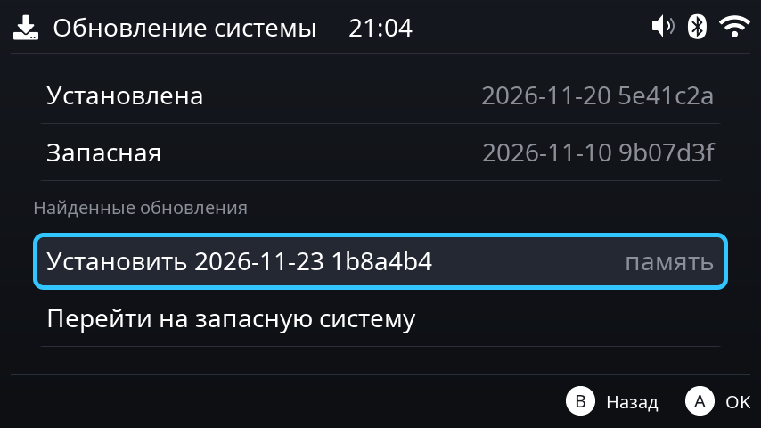
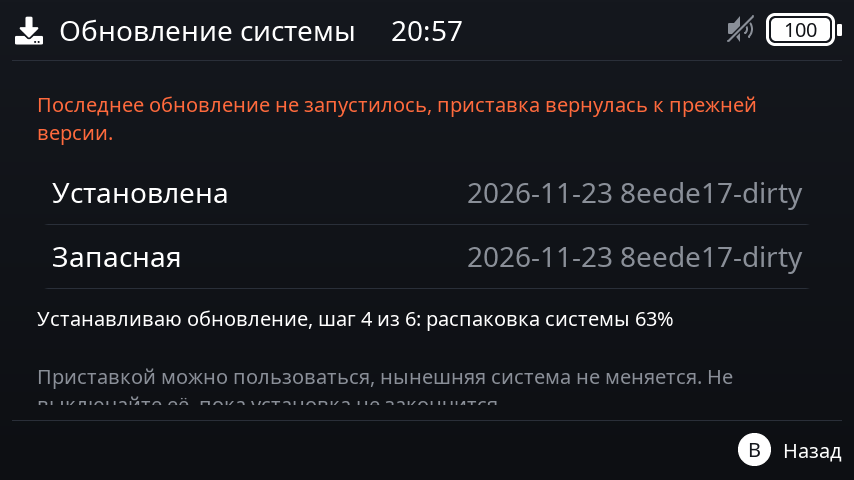

# Обновление системы

У ODROID-GO Ultra в памяти две копии системы: та, что работает, и **запасная**.
Обновление ставится на место запасной, а работающая система остаётся как была. Если
новая версия не запустится, приставка сама вернётся к прежней. Игры на карте,
сохранения и настройки при обновлении не трогаются.

## Где взять обновление

Обновление — один файл с расширением `.upd`, например `ogu-2026-11-23-1b8a4b4.upd`
(около 130 МБ). Положите его на карту игр в папку `updates`:

1. На главном экране выберите круглую кнопку «USB-диск» (первая под плитками) и
   подключите приставку кабелем к компьютеру. Карта игр появится как обычный диск.
2. Создайте на ней папку `updates`, если её нет, и скопируйте туда файл.
3. Извлеките диск на компьютере и нажмите B на приставке.

Можно и просто вынуть карту и вставить её в картридер. Файл в корне карты тоже
найдётся.

## Установка

Откройте Настройки → Система → «Обновление системы».

- **Установлена** — версия, которая работает сейчас.
- **Запасная** — версия во второй копии.
- **Найденные обновления** — файлы с карты. Около каждого написано, где он лежит
  («карта» или «память»). Обновление той же версии, что уже работает, не
  показывается.

Выберите «Установить …» и подтвердите. Установка занимает около полутора минут:
на экране видны шаг и проценты. Приставкой в это время можно пользоваться, но не
выключайте её, пока установка не закончится. Если выключить посередине, ничего не
сломается, просто обновление нужно будет поставить заново.

Когда установка закончится, выберите «Перезагрузить сейчас». Приставка запустится с
новой системой, примерно через полминуты новая версия станет основной. Не хотите
перезагружаться сразу — нажмите B: новая система включится при следующем включении
приставки.

Настройки приставки (громкость, яркость, управление игр, сети Wi-Fi, сопряжённые
Bluetooth-устройства) переносятся в новую систему сами.

## Если новая версия не запустилась

Если новая система трижды подряд не смогла запуститься, приставка сама вернётся к
прежней. После этого на экране появится сообщение «Последнее обновление не
запустилось, приставка вернулась к прежней версии». Оно же видно на экране
обновления. Сохраните отчёт (Настройки → Система → «Сохранить отчёт») и отправьте
его вместе с названием файла обновления.

Если новая система зависла и не реагирует на кнопки, держите кнопку питания, пока
приставка не выключится, и включите её снова. Каждое такое включение считается
попыткой. После третьей приставка вернётся к прежней версии.

## Вернуться к прежней версии

Если новая версия запустилась, но чем-то не нравится, на экране обновления выберите
«Перейти на запасную систему». Приставка перезагрузится с запасной копией, а
нынешняя станет запасной. Вернуться обратно можно так же.
