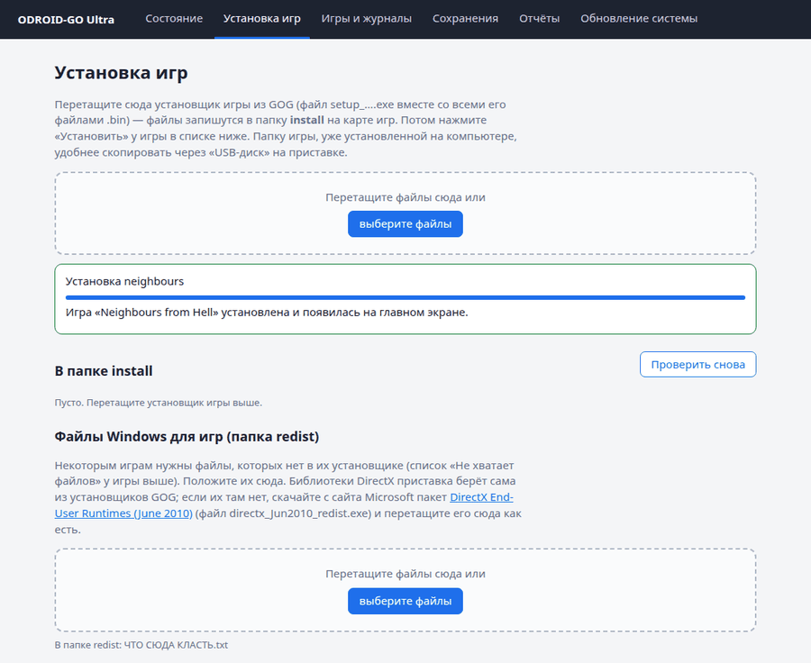
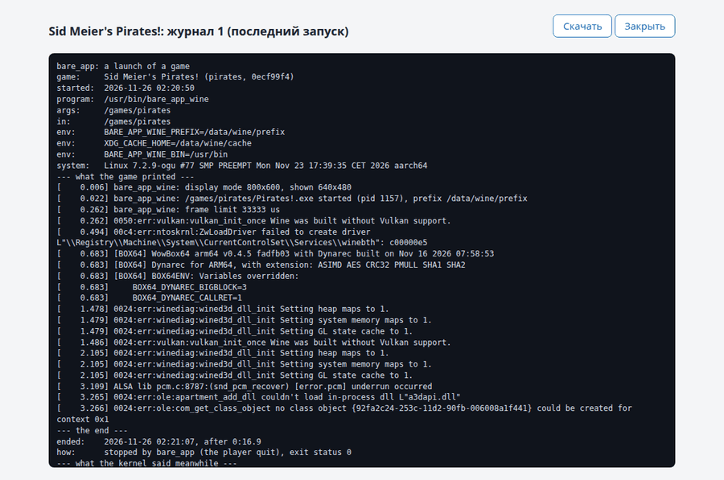
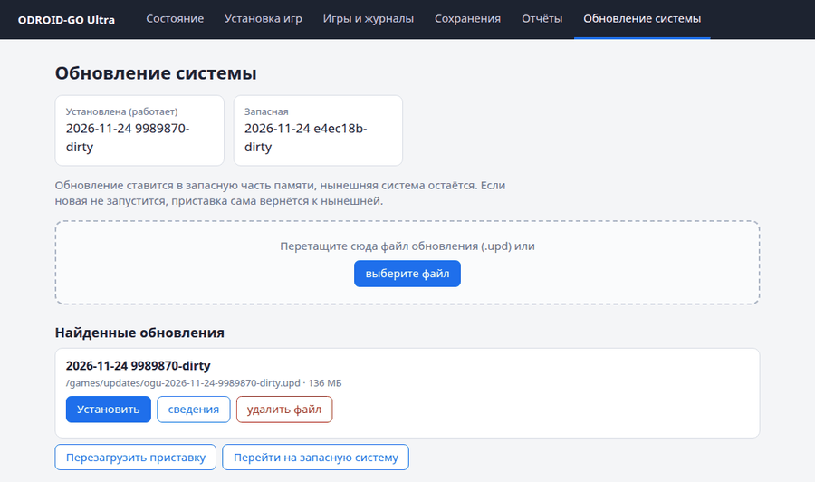

# Приставка в браузере

Приставку можно подключить к компьютеру кабелем и управлять ею в браузере: поставить
игру, прочитать журнал, забрать отчёт, поставить обновление. Всё это делается и другими
способами (через «USB-диск» и карту), браузер просто удобнее: игры могут идти, карта не
отключается, ничего не нужно вынимать и извлекать.

## Что нужно

- Кабель USB-C из приставки в компьютер.
- Компьютер с Windows 11, macOS или Linux. Ничего ставить не нужно: компьютер сам видит
  приставку как сетевую карту. На Windows 11 она называется «UsbNcm Host Device».
- Любой браузер.

У Windows 10 нужного драйвера нет. С ней пользуйтесь «USB-диском» и картой, как
написано в главах [«Установка игр»](05-install.md) и [«Обновление системы»](30-update.md).

Режим «USB-диск» включать не нужно. Если он включён, карта отдана компьютеру, и сайт
не может в неё писать (см. таблицу ниже).

## Как открыть

Включите приставку, дождитесь главного экрана, подключите кабель. Через несколько секунд
откройте в браузере адрес:

```
http://192.168.7.2
```

Если к одному компьютеру подключены две приставки, у второй адрес другой:
`http://192.168.8.2`.

Адрес начинается с `http`, не с `https`. Сайт отвечает только компьютеру на кабеле: по
Wi-Fi и из домашней сети он не виден.

Наверху страницы меню: «Состояние», «Установка игр», «Игры и журналы», «Отчёты»,
«Обновление системы».

## Состояние

Первая страница. Она показывает, какая система стоит («Система»), из какой части памяти
она работает, сколько места свободно на карте игр и в памяти приставки (`/data`), заряд
батареи и название приставки. Если идёт установка или обновление, появится строка
«Сейчас идёт».

Если карта отдана компьютеру, в строке «Карта игр» написано «отдана компьютеру как
USB-диск». Если карты нет, написано «не вставлена». В обоих случаях загружать файлы
нельзя: верните карту (кнопка B в режиме «USB-диск») или вставьте её.

## Установка игр



1. Перетащите в серую зону установщик из GOG: файл `setup_….exe` **вместе со всеми его
   файлами `.bin`**. Или нажмите «выберите файлы» и отметьте их. Можно несколько игр
   сразу.
2. Файлы грузятся по очереди. Для каждого видны проценты и скорость в МБ/с. Когда
   файл записан, рядом появится «записан».
3. В списке «В папке install» найдите игру и нажмите «Установить». Список такой же, как
   на экране «+» на приставке.
4. Появится строка «Шаг … из …» с процентами. Когда всё готово, плитка игры уже на
   главном экране, приставку перезапускать не нужно.

Папку игры целиком браузер не загружает. Если игра уже стоит на компьютере, скопируйте её
папку через «USB-диск» (глава [«Установка игр»](05-install.md)). Страница об этом
напоминает.

Сколько это занимает. Карта пишет около 9 МБ/с. Установщик Cold Fear (1,7 ГБ)
загружается около трёх минут, ещё около четырёх минут он ставится.

Не выключайте приставку и не выдёргивайте кабель, пока идёт загрузка или установка.
Если загрузка оборвалась, недописанный файл удаляется сам. Если он всё же остался, его
видно в списке как «Недогруженный файл …», его можно удалить кнопкой «Удалить».

| Что вижу | Что это значит | Что делать |
|---|---|---|
| «новая» | игра известна приставке, её ещё нет на карте | нажмите «Установить» |
| «уже установлена» | игра уже стоит | «Установить заново» поставит её заново, сохранения останутся |
| «приставка не знает эту игру» | готовых настроек нет | выберите программу, которая запускает игру («Программа, которая запускает игру»), при желании измените «Название на главном экране», нажмите «Установить» |
| «этот установщик приставка не распаковывает» | установщик не от GOG | установите игру на компьютере и скопируйте папку через «USB-диск» |
| «Не хватает файлов: …» | игре нужны файлы Windows, которых в установщике нет | положите их в зону «Файлы Windows для игр (папка redist)» ниже и нажмите «Проверить снова» |
| «В ней не найдено программ Windows (.exe)» | запускать нечего | проверьте, что скопировали всю папку или все файлы установщика |
| кнопка «Удалить» | убирает установщик или папку из `install` | установленные игры она не трогает |

Библиотеки DirectX приставка берёт из установщиков GOG. Если игре их не хватает,
скачайте пакет «DirectX End-User Runtimes (June 2010)» (ссылка есть на странице,
файл `directx_Jun2010_redist.exe`) и перетащите его в зону redist как есть. Подробнее о
файлах Windows см. главу [«Установка игр»](05-install.md).

Второй раз одно и то же имя файла можно загружать, только когда первая загрузка
закончилась. Две установки сразу приставка не делает: пока идёт одна, вторая не
запустится.

## Игры и журналы



Таблица игр: название, размер, последний запуск и кнопки «журнал 1», «журнал 2»,
«журнал 3». Журнал 1 — последний запуск, 2 и 3 — запуски до него. У игры, которую ещё
не запускали, написано «не запускалась».

Нажмите на кнопку журнала: текст откроется под таблицей целиком. «Скачать» сохранит его
файлом, «Закрыть» уберёт. О том, что искать в журнале, см. главу
[«Если игра не работает»](20-problems.md).

Кнопка «отчёт» в строке игры собирает отчёт об этой игре.

## Отчёты

Нажмите «Сделать отчёт»: через несколько секунд появится «Готово: …», и файл попадёт в
список. Он же лежит на карте игр в папке `reports`. В списке у каждого отчёта кнопки
«открыть», «скачать» и «удалить». Если карты нет, отчёт ложится в память приставки.

В отчёте нет паролей Wi-Fi и ключей. Приложите скачанный файл к сообщению об ошибке.

## Обновление системы



Страница повторяет экран обновления на приставке (см. главу
[«Обновление системы»](30-update.md)).

1. Вверху видно, какая версия «Установлена (работает)» и какая «Запасная».
2. Перетащите в серую зону файл `.upd` или нажмите «выберите файл». Загрузка файла около
   130 МБ занимает меньше полуминуты.
3. Файл появится в списке «Найденные обновления». Кнопка «сведения» покажет, что в нём.
   Если файл не для этой приставки, «Установить» не нажимается.
4. Нажмите «Установить» и подтвердите. Видны шаги и проценты. Установка занимает меньше
   минуты.
5. Когда она закончится, нажмите «Перезагрузить приставку». Обновление ставится в
   запасную часть памяти; если новая система не запустится, приставка сама вернётся к
   прежней.
6. «Перейти на запасную систему» перезагружает приставку с запасной копией, как на
   экране обновления.

«удалить файл» убирает загруженный `.upd` с приставки.

## Если страница не открывается

| Что вижу | Что делать |
|---|---|
| браузер пишет, что сайт недоступен | проверьте, что кабель вставлен в порт USB-C приставки (не в другой), а приставка включена и показывает главный экран; подождите полминуты после подключения |
| не открывается и всё в порядке | проверьте, что адрес начинается с `http://`, а не `https://` |
| в адресе всё верно, но на компьютере нет новой сети | у Windows 10 нет драйвера; используйте «USB-диск» |
| две приставки на одном компьютере | у первой `192.168.7.2`, у второй `192.168.8.2` |
| «Приставка не отвечает. Проверьте кабель USB.» | кабель отошёл или приставка выключилась; вставьте кабель и обновите страницу |
| при загрузке сообщение об ошибке, файлы не пишутся | карта не вставлена или отдана компьютеру как «USB-диск»; верните её, нажав B на приставке |
| «Папки целиком отсюда не загружаются…» | вы перетащили папку; перетащите файлы из неё или используйте «USB-диск» |
| «Это не файл обновления (.upd)» | на странице обновления нужен файл с расширением `.upd` |
