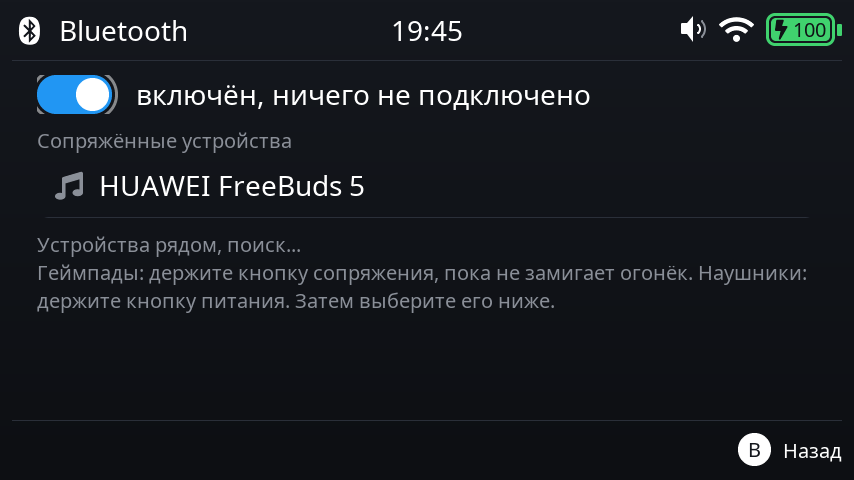
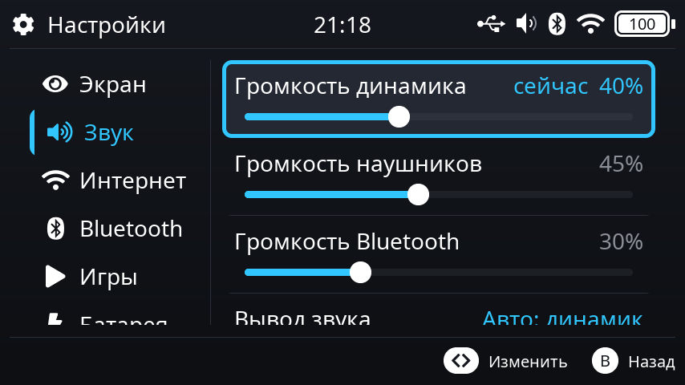

# USB-адаптер: Wi-Fi и Bluetooth

У приставки нет своего Wi-Fi и Bluetooth. Их даёт маленький USB-адаптер в порту USB-A.
Один адаптер включает сразу оба: сеть и наушники.

## Какой адаптер взять

Проверен **TP-Link Archer TX10UB Nano**. Другие адаптеры на чипах, которые знает ядро
системы, тоже должны работать, но на них не проверялось. Старый TP-Link Archer T3U Plus
даёт только Wi-Fi, Bluetooth у него нет.

## Как подключить

1. Вставьте адаптер в порт USB-A. Вынимать и вставлять можно в любой момент, приставку
   выключать не нужно.
2. Подождите секунду. Некоторые адаптеры сначала показываются как «диск с драйверами».
   Приставка сама переводит их в рабочий режим.
3. Wi-Fi подключается к сохранённой сети сам. Новую сеть задайте в Настройки → Wi-Fi:
   A на сети из списка, пароль набирается на экранной клавиатуре; X два раза забывает
   сохранённую сеть.
4. Bluetooth настраивается в Настройки → Bluetooth (см. ниже).

Сайт приставки по Wi-Fi (глава [«Приставка в браузере»](40-web.md)) работает через этот
же адаптер.

## Подключить наушники

На экране Настройки → Bluetooth три части:

- переключатель Bluetooth, под ним строка вроде «включён, ничего не подключено»;
- «Сопряжённые устройства»: то, что вы уже подключали;
- «Устройства рядом, поиск…»: поиск идёт, пока экран открыт.

Как подключить новое устройство:

1. Откройте Настройки → Bluetooth.
2. Переведите устройство в режим сопряжения. Геймпад: держите кнопку сопряжения, пока не
   замигает огонёк. Наушники: держите кнопку питания.
3. Дождитесь, пока оно появится в списке «Устройства рядом».
4. Выберите его и нажмите A. Приставка свяжется с ним и подключится.

| Кнопка | Что делает |
|---|---|
| A на устройстве рядом | связать и подключить |
| A на сопряжённом | подключить или отключить |
| X два раза | забыть устройство |
| B | назад |

Наушники и геймпады обычно связываются без вопросов. Иногда приставка просит подтвердить
код: нажмите A.

| Что вижу | Что это значит | Что делать |
|---|---|---|
| окно с кодом при подключении клавиатуры | клавиатура просит ввести код | наберите код на самой клавиатуре; B отменяет |
| окно «… показывает этот код?» | устройство и приставка показывают один код | если коды совпали, A (да); если нет, B (нет) |
| устройства нет в списке рядом | оно не в режиме сопряжения | держите кнопку сопряжения или питания, пока не замигает огонёк |

Ключи сопряжения хранятся на приставке и переживают обновление системы (глава
[«Обновление системы»](30-update.md)). Пароли Wi-Fi и ключи Bluetooth не попадают в
копию сохранений (глава [«Сохранения»](45-saves.md)).

## Звук и громкость

У приставки три выхода звука: динамик, проводные наушники (в разъём) и Bluetooth-наушники.
Громкость у каждого своя. Динамик не станет тише оттого, что вы убавили наушники.

- Кнопки громкости меняют громкость того выхода, который звучит сейчас. Во всплывающей
  подсказке громкости написано, какой это выход: «Динамик», «Наушники» или «Bluetooth».
- В Настройки → Звук три строки: «Громкость динамика», «Громкость наушников» и
  «Громкость Bluetooth». Строка Bluetooth видна, когда есть адаптер. У выхода, который
  звучит сейчас, рядом написано «сейчас NN%».
- Если вы обновили приставку со старой версии, все три громкости сначала равны прежней.
- «Вывод звука» в Настройки → Звук (и в быстром меню по F6) имеет три значения: «Авто»,
  «Динамик», «Наушники».

**Как работает «Авто».** На ODROID-GO Ultra вставили штекер в разъём: звук и громкость сразу
переходят на наушники, в настройках будет написано «Авто: наушники». Вынули
штекер: звук возвращается в динамик, с его громкостью. Если выбрано «Динамик» или
«Наушники» вручную, штекер ничего не меняет.

**Bluetooth-наушники главнее проводных.** Пока они подключены, звук идёт в них.

- Звук по Bluetooth идёт с задержкой около четверти секунды. Это свойство Bluetooth, не
  поломка.
- Если выключить наушники или убрать в кейс во время игры, через пару секунд звук
  возвращается в динамик (или в проводные наушники, если они вставлены). Когда вы
  включите Bluetooth-наушники, они подключатся сами и заберут звук.
- Трансляция на сайт приставки (вкладка «Проверка», глава
  [«Мастерская»](50-workshop.md)) и наушники работают вместе: в браузере слышен тот же
  звук.

| Что вижу | Что это значит | Что делать |
|---|---|---|
| после перезагрузки приставки наушники молчат | сами они после перезагрузки не подключаются | выберите их на экране Bluetooth (A) или откройте кейс заново |
| наушники с двумя вкладками (TWS): кейс закрыли во время подключения, звука нет | подключение оборвалось, повторного может не быть | откройте кейс ещё раз или выберите наушники на экране Bluetooth |

## Геймпады и клавиатуры по Bluetooth

Геймпады и клавиатуры связываются с экрана Настройки → Bluetooth так же, как наушники
(см. выше). Проверено с Switch Pro Controller и парой Joy-Con: они работают и в меню, и в
играх. Другие Bluetooth-геймпады и клавиатуры (NES и SNES Online и т. д.) поддерживаются,
но на них не проверялось.

- Кнопка Capture (квадратная, слева от Home) на Switch-геймпадах работает как F3
  приставки (в играх это обычно сохранение).
- После засыпания приставки геймпад подключается сам по нажатию любой кнопки.
- Пара Joy-Con работает как один геймпад: крестовина и левый стик с левого Joy-Con, кнопки
  и правый стик с правого. Кнопки SL/SR на рельсах в паре не используются.
- Курки внешних геймпадов можно поменять местами: Настройки → Игры → «Курки внешних
  геймпадов», значение «L1/L2, R1/R2 наоборот». Тогда большие курки ZL/ZR работают как
  L1/R1, а бамперы как L2/R2. Действует на все USB- и Bluetooth-геймпады сразу, на кнопки
  самой приставки не влияет; переназначения кнопок в «Управлении» игры применяются уже
  к поменянным куркам.

| Что вижу | Что это значит | Что делать |
|---|---|---|
| геймпад и Bluetooth-наушники вместе: геймпад не подключается | наушники подключились первыми, и адаптеру не хватает эфира на геймпад | уберите наушники в кейс, подключите геймпад кнопкой, затем снова достаньте наушники: в таком порядке работают оба |
| несколько Bluetooth-геймпадов, связь рвётся | пара Joy-Con работает, а третье устройство (например, Pro Controller рядом с парой) перегружает адаптер; это дорабатывается | подключайте один геймпад или одну пару Joy-Con |
