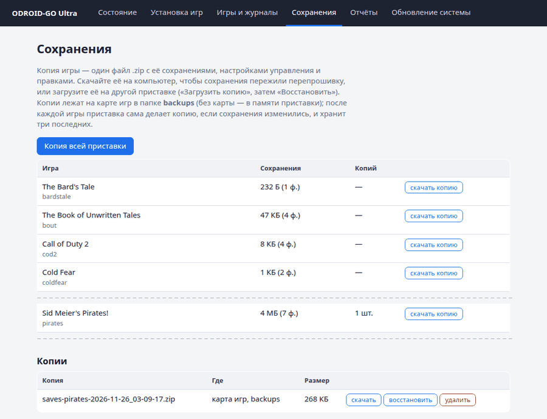

# Сохранения: копия и перенос

Сохранения лежат в памяти приставки (`/data`). Если систему перепрошить или приставка
сломается, они могут пропасть. Поэтому их стоит копировать. Копия — один файл `.zip`.
Её можно скачать на компьютер, положить на другую приставку или просто хранить.

Копии делаются на странице «Сохранения» в браузере (глава
[«Приставка в браузере»](40-web.md)) и сами после игры.

## Что входит в копию

**Копия игры** (`saves-<папка игры>-<дата>.zip`):

- сохранения и настройки самой игры из памяти приставки;
- ваша раскладка кнопок для этой игры (экран управления, X на плитке) и опции игры
  (например, предел кадров);
- ваши правки настроек игры, если вы их делали в «Мастерской» (глава
  [«Мастерская»](50-workshop.md)).

**Копия всей приставки** (`saves-all-<дата>.zip`): то же для всех игр сразу и папка
правок. Пароли Wi-Fi и ключи Bluetooth в неё не попадают. Общие настройки приставки
(яркость, громкость и т. п.) лежат в файле для справки, но обратно не восстанавливаются.
Восстанавливаются игры и их раскладки.

**Чего в копии нет:** самой игры. Папка игры на карте (`/games/<папка>`) — это
установка, а не сохранения. Если игры на приставке нет, сначала поставьте её (глава
[«Установка игр»](05-install.md)), потом восстанавливайте сохранения. Данные восстановятся
и без игры, но играть, пока её нет, нельзя.

## Страница «Сохранения»

Откройте `http://192.168.7.2` и выберите «Сохранения».

| Что вижу | Что это значит | Что делать |
|---|---|---|
| таблица игр: «Игра», «Сохранения», «Копий» | сколько места занимают данные игры и сколько у неё копий | — |
| «нет данных» | у игры нет сохранений | копировать нечего |
| «скачать копию» в строке игры | делает копию этой игры и скачивает её | подождите, пока появится «Готово: …» |
| «Копия всей приставки» | то же для всех игр; на карте с десятками игр это до минуты, не закрывайте страницу | подождите «Готово: …» |
| «запущена» под названием игры | игра идёт сейчас | восстановить её сохранения нельзя, выйдите из игры |
| «Загрузить копию с компьютера» | серая зона для файла `saves-….zip` | перетащите файл или нажмите «выберите файл» |
| «Это не копия сохранений (saves-….zip)» | файл называется не так | загружайте только копии, сделанные приставкой |
| список «Копии»: «скачать», «восстановить», «удалить» | все копии на приставке | см. ниже |
| «сделана сама после игры» | это автокопия | см. ниже |

Каждая копия сохраняется ещё и на самой приставке в папке `backups`: «Готово: …
(она же лежит в папке backups)». С картой игр это `backups` на карте, без карты —
`/data/backups` в памяти приставки (в списке видно, где именно).

### Восстановить

1. Выйдите из игры на приставке. **Пока игра запущена, приставка восстановление не
   начнёт.**
2. Если копия лежит на компьютере, перетащите её в зону «Загрузить копию с компьютера».
   Она появится в списке «Копии».
3. Нажмите «восстановить» у нужной копии. Страница покажет, из какой приставки и когда
   она сделана и какие игры в ней, и спросит подтверждение. **Нынешние сохранения этих
   игр будут заменены.**
4. Дождитесь «Восстановлено: …».

Если что-то пошло не так посреди восстановления (копия повреждена, не хватило места),
приставка возвращает прежние сохранения: ничего не остаётся «наполовину».

«удалить» стирает копию с приставки, после вопроса.

## Автокопия

После выхода из игры приставка сама делает её копию, если сохранения изменились. Она
ложится в `backups` на карте и называется `…-auto.zip`. Хранятся три последних
автокопии каждой игры, более старые удаляются. Копии, которые вы сделали сами,
приставка не трогает.

Это страховка на случай, когда система перепрошита и `/data` потерялось: автокопии
остались на карте.

Автокопию можно выключить только строкой `autobackup=0` в настройках приставки
(`bare_app.conf`): пункта в меню пока нет.

## Перенос на другую приставку

1. На первой приставке откройте страницу «Сохранения» и нажмите «скачать копию»
   (или «Копия всей приставки»).
2. На второй приставке откройте её страницу «Сохранения» и перетащите файл в зону
   «Загрузить копию с компьютера».
3. Поставьте на второй приставке ту же игру, если её ещё нет.
4. Нажмите «восстановить» у загруженной копии.

Если обе приставки подключены к одному компьютеру, откройте две вкладки: первая
приставка — `http://192.168.7.2`, вторая — `http://192.168.8.2`. Копия скачивается в папку
загрузок компьютера; перетащите её оттуда на вторую вкладку.

Перед переносом на приставку, где уже есть сохранения, сделайте копию и там: восстановление
заменяет её нынешние сохранения этих игр.

## Копии без сети

Копии лежат на карте игр, в папке `backups`. Включите на приставке режим «USB-диск»
(круглая кнопка, первая под плитками), подключите кабель: папка `backups` видна на
компьютере как обычная. Оттуда копию можно взять, а положить обратно в `backups` и
восстановить через браузер.

Если карты нет, копии лежат в памяти приставки и в «USB-диске» не видны: забирайте их
через страницу в браузере.
