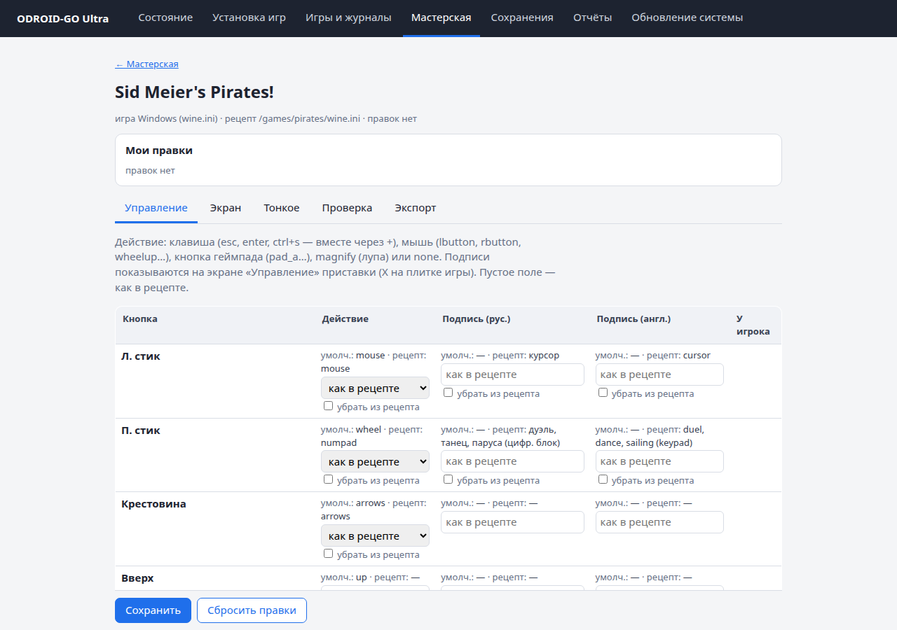
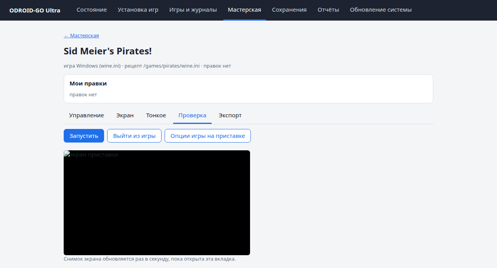

# Мастерская: настройка любой игры

«Мастерская» — страница в браузере, где можно поменять настройки запуска игры: кнопки,
разрешение, переменные Wine. Она для тех, кто готов повозиться: если игра ведёт себя
странно, а ответа в журнале нет, можно подобрать настройки самому и сразу проверить.
Если вы просто играете, она не нужна.

Нужен компьютер с кабелем и открытая страница приставки (глава
[«Приставка в браузере»](40-web.md)).

## Как открыть

«Игры и журналы» → в строке игры кнопка «мастерская». У игр, встроенных в систему
(Герои III, Half-Life, DOOM), кнопка называется «проверка»: у них нет рецепта, который
можно править.

Наверху страницы название игры и строка: какая это игра, откуда рецепт и есть ли правки
(«правок нет» или путь к файлу правок).

## Рецепт и правки

Для каждой игры у приставки есть **рецепт**: готовые настройки запуска (какое
разрешение, что делает каждая кнопка, какие переменные нужны). Игры без рецепта
получили настройки по умолчанию при установке.

Мастерская не переписывает рецепт. Ваши изменения лежат **поверх** него отдельным
файлом на карте игр, в папке `recipes`:

```
/games/recipes/<папка игры>/wine.ini
```

Поэтому:

- в файле правок хранятся только отличия от рецепта;
- переустановка игры и обновление системы правки не стирают;
- правки можно целиком отменить кнопкой «Сбросить правки»: останется рецепт;
- то же можно сделать на самой приставке (см. ниже);
- правки входят в копию сохранений игры (глава [«Сохранения»](45-saves.md)).

### Сбросить правки на приставке

Если у игры есть правки Мастерской, на её экране опций (Y на плитке) есть пункт
«Сбросить правки Мастерской». Нет правок, нет и пункта.

1. Выйдите из игры, если она идёт, и нажмите Y на плитке.
2. Выберите «Сбросить правки Мастерской» и нажмите A.
3. Приставка спросит: «Сбросить правки Мастерской для игры … ? Папка … будет удалена:
   игра снова пойдёт по своему рецепту.» Подтвердите кнопкой «Сбросить».
4. Появится «Правки Мастерской сброшены». Пункт исчезнет, игра пойдёт по рецепту.

Рядом с каждым полем видны три значения:

| Что вижу | Что это |
|---|---|
| «умолч.» | что делает приставка, если в рецепте ничего не сказано |
| «рецепт» | что написано в рецепте игры |
| поле ввода | ваша правка; пустое поле (или «как в рецепте») значит «не менять» |

Если нужно убрать настройку рецепта совсем, отметьте «убрать из рецепта».

Внизу страницы кнопки:

| Кнопка | Что делает |
|---|---|
| «Сохранить» | записывает правки на карту; «Сохранено: …» |
| «Сбросить правки» | после подтверждения удаляет все правки игры |
| «Перенести управление игрока в рецепт» | см. вкладку «Управление» |

Пока в поле ошибка, страница красным пишет, что не так («одно из: …», «целое число»,
«от … до …»), и не сохраняет. Если на странице есть несохранённые правки, она
напоминает об этом при уходе.

**Правки действуют со следующего запуска игры.** Идущую игру они не меняют: выйдите из
неё и запустите снова.

Для записи приставка на время открывает карту на запись. Если карты нет или она отдана
компьютеру («USB-диск»), сохранить не получится.

## Вкладки

У игр Windows пять вкладок: «Управление», «Экран», «Тонкое», «Проверка», «Экспорт».

### Управление



Таблица кнопок:

| Столбец | Что это |
|---|---|
| Кнопка | кнопка приставки: стики, крестовина, A, B, X, Y, L1/R1, L2/R2, F1–F6 |
| Действие | что она делает в игре |
| Подпись (рус.), Подпись (англ.) | что написано на экране «Управление» на приставке (X на плитке) |
| У игрока | если вы сами переставили кнопку на экране управления, здесь видно, как («как B», «ничего») |

Действие можно выбрать из списка или вписать: клавиша клавиатуры (`esc`, `enter`; для
сочетания клавиши вместе через `+`, например `ctrl+s`), кнопка мыши (`lbutton`,
`rbutton`, `wheelup`…), кнопка геймпада (`pad_a`…), `magnify` (лупа) или `none`
(ничего). У стиков и крестовины действия свои: например, стик может быть курсором
мыши. Строки крестовины и «стик вверх» и т. п. появляются, когда она работает как
стрелки.

**Подсказка при старте** (`hint.ru` и `hint`) собирается из подписей сама, пока вы её
не правили. Нажмите «Собрать из подписей», чтобы пересобрать её заново.

**«Перенести управление игрока в рецепт».** Если вы переставили кнопки этой игры на
приставке (экран управления), то это ваша личная раскладка, и она лежит только у вас.
Кнопка записывает её в правки игры: кнопки и подписи, а у игрока раскладка очищается.
Так раскладка станет частью настроек игры и попадёт в экспорт. Инверсия осей и
чувствительность стиков остаются у игрока.

Кнопка видна, только если у игрока есть что переносить. Приставка отклоняет перенос, если:

| Что вижу | Что делать |
|---|---|
| «Игра идёт: перестановка кнопок игрока сейчас действует. Выйдите из игры.» | выйдите из игры |
| «У игрока нет своей перестановки кнопок этой игры.» | переносить нечего |
| «В перестановке игрока нет кнопок, которые можно перенести в [keys].» | в ней только оси и стики: они остаются у игрока |
| «Правки этой игры не читаются: сначала сбросьте их.» | нажмите «Сбросить правки» |

Перед переносом несохранённые правки на странице пропадут: сначала сохраните их.

### Экран

Разрешение и режимы (`mode`, `modes`), сколько строк показывать (`rows`), масштаб
(`scale`), курсор и его скорость (`cursor`, `cursor_speed`), предел кадров
(`fps_limit`), яркость (`gamma`). У каждого поля рядом написано, что оно значит.

### Тонкое

Остальные настройки: переменные для Wine и эмулятора (`env`), библиотеки (`dlls`),
значения реестра (`reg`), папки, куда игре разрешено писать (`writable`), сохранения
(`saves`), язык (`locale`), параметры запуска (`args`) и прочее. У каждого поля есть
подсказка по-русски. Если в рецепте есть ключи, которых страница не знает, они тоже
видны как текст.

Под таблицей **«Заготовки env»**: готовые наборы переменных, которые уже помогли
другим играм (например, настройки Box64 или кэша Wine). «добавить» вписывает заготовку
в `env`, не удаляя остальное. Подробности о заготовке написаны рядом.

Не меняйте здесь то, чего не понимаете: неудачная правка может не дать игре запуститься.
«Сбросить правки» вернёт всё как было.

### Проверка



Здесь можно запустить игру и посмотреть, что она делает, не глядя на приставку.

- Кнопки «Запустить», «Выйти из игры» и «Опции игры на приставке».
- Карточки: «Игра» (идёт, не запущена, свёрнута), «Кадров в секунду», «CPU игры»,
  «GPU», «Память игры». Обновляются раз в секунду.
- **Снимок экрана** приставки раз в секунду, пока вкладка открыта.
- **Виртуальный геймпад**: L2, L1, R1, R2, крестовина, X, Y, A, B, F1–F6 (Select и Start,
  если они есть у приставки) и два стика (стрелки). Кнопка нажата, пока вы держите её
  мышью. Чтобы выйти из игры кнопкой F6, её надо держать 2 секунды.
- **Журнал запуска живьём**: строки появляются по ходу игры; новый запуск начинается со
  строки «— новый запуск —».

Правки с вкладок «Управление», «Экран» и «Тонкое» вступают в силу при следующем
запуске: поменяли, сохранили, нажали «Запустить» и смотрите.

Нельзя запустить игру, пока идёт другая. Нельзя открыть «Опции игры на приставке», пока
игра идёт.

### Экспорт

Кнопка «Скачать рецепт (zip)» собирает архив: настройки игры с вашими правками,
обложку, заготовку описания, секцию для списка игр и журнал последнего запуска. Он
нужен, чтобы передать удачные настройки разработчикам прошивки (разработчик раскладывает
его скриптом `scripts/recipe-import.py` на компьютере) или забрать их себе.

В архив попадает только сохранённое: если на странице есть несохранённые правки,
страница сначала спросит.

**На другую приставку архив сейчас не загружается сам.** Загрузки на странице нет. Если
очень нужно, файл `overlay/wine.ini` из архива можно положить вручную в
`/games/recipes/<папка игры>/wine.ini` на карте игр другой приставки (через режим
«USB-диск»). Для обычного переноса настроек проще копия
сохранений (глава [«Сохранения»](45-saves.md)): в неё правки уже входят.

## Игры со своим движком

У Героев III, Half-Life и DOOM нет рецепта Windows. Для них есть только вкладка
«Проверка» (кнопка в списке называется «проверка»). У остальных игр на своих программах
(настройки в `game.ini`) вкладки «Тонкое», «Проверка» и «Экспорт».
