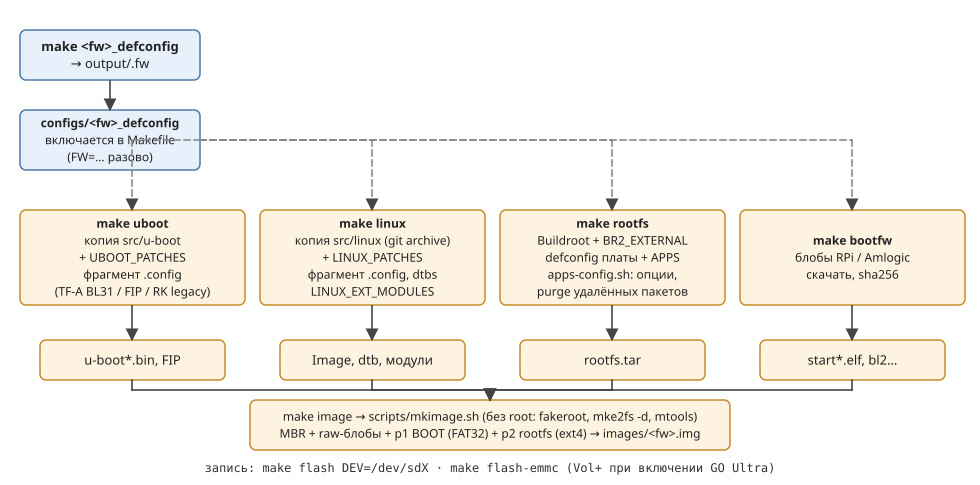

# 1. Устройство SDK

## Идея

Один репозиторий собирает прошивки пяти плат из **одних и тех же исходников**:
различаются только конфиги. Исходники компонентов — git-сабмодули в `src/`, и
они никогда не правятся на месте: ядро и U-Boot собираются из **копии**
закоммиченного дерева с наложенными патчами платы, Buildroot накладывает патчи
пакетов при распаковке. Всё, что получилось, лежит в `output/<прошивка>/`.

| Компонент | Каталог | Версия | Роль |
|---|---|---|---|
| TF-A (BL31) | `src/tf-a` | v2.15.0 | монитор EL3 на Rockchip (GO Advance) |
| U-Boot | `src/u-boot` | v2026.07 | загрузчик всех плат, читает `extlinux.conf` |
| Linux | `src/linux` | v7.2.9 | ядро, arm64 и arm |
| Buildroot | `src/buildroot` | 2026.08 | корневая ФС, тулчейн, пакеты |
| bare_app | `apps/bare_app` | свой репозиторий | лаунчер (сабмодуль с LVGL и doomgeneric внутри) |

## Дерево репозитория

```
Makefile                        оркестратор: цели сборки, умолчания, склейка образа
configs/<fw>_defconfig          конфиг прошивки (плоский список make-переменных)
board/<плата>/                  всё, что отличает плату:
   u-boot/*.config, patches/       фрагмент поверх defconfig U-Boot, патчи
   linux/*.config, patches/        фрагмент ядра, патчи (GO Ultra — 31, GO Advance — 3)
   linux/<модуль>/                 внешние модули ядра (esp8089, rk-vepu-h264, meson-venc)
   buildroot/defconfig, overlay    defconfig Buildroot платы, её rootfs-overlay, post-build.sh
   boot/                           файлы раздела BOOT (boot.ini у GO Ultra, config.txt у RPi)
   fip/, rkbin/                    хеши блобов Amlogic; блобы и утилиты Rockchip
board/common/buildroot/         BR2_EXTERNAL «SDK»: общий overlay (S05data, games-mount,
                                usb-disk), post-build, пакеты package/<pkg>/
apps/bare_app/                  лаунчер; apps/oga-pad — пример приложения
games/                          манифест игр, wine.ini и prepare.sh каждой Windows-игры
scripts/                        склейка образа, прошивка, игры на карту, управление платой
docs/                           документация и книги; docs/wiki — эта вики
dl/                             кэш загрузок (общий для всех прошивок)
lab/ -> /media/D/OdroidLab      данные вне git: игры, образы, бэкапы, wip
output/<fw>/                    результаты сборки прошивки
```

Правило: **плата описывается в `board/` и `configs/`, код живёт в сабмодулях,
результат только в `output/`.** Руками в `output/` ничего не правят.

## Поток сборки



`make <fw>_defconfig` только записывает имя прошивки в `output/.fw`; все
следующие команды без `FW=` берут её оттуда и включают
`configs/<fw>_defconfig` прямо в Makefile. `FW=ogu make linux` действует разово
и выбор не меняет. Компоненты собираются **по очереди** (`.NOTPARALLEL`), каждый
со своим `-j$(JOBS)`: верхний `make -j` запустил бы U-Boot, ядро и Buildroot
одновременно — втрое больше памяти.

| Цель | Что делает | Куда |
|---|---|---|
| `make uboot` | копия `src/u-boot` + `UBOOT_PATCHES` + фрагмент; на Rockchip ещё TF-A и упаковка `uboot.img`/`trust.img` (`RK_LEGACY`), на Amlogic — FIP из скачанных блобов (`scripts/amlogic-fip.sh`) | `images/u-boot*.bin`, `u-boot-fip.bin` |
| `make linux` | `git archive` из `src/linux` в `output/<fw>/linux-src`, патчи, фрагмент `.config`, dtb, внешние модули | `linux-install/`: `Image`, dtb, модули |
| `make rootfs` | Buildroot с `BR2_EXTERNAL=board/common/buildroot`, defconfig платы + приложения из `APPS` | `images/rootfs.tar` |
| `make bootfw` | блобы прошивки RPi (проверка sha256) | `images/` |
| `make image` | `scripts/mkimage.sh`: без root (fakeroot, `mke2fs -d`, mtools) | `images/<fw>.img` (+ `<fw>-emmc.img`) |
| `make flash DEV=…` | запись с проверками (`scripts/flash.sh`); `flash-boot` — только загрузчик и BOOT | карта |
| `make flash-emmc` | eMMC GO Ultra, показанная U-Boot как USB-диск (Vol+ при включении) | eMMC |

У каждого компонента есть `-menuconfig`, `-savedefconfig`, `-configure`, `-clean`;
`make rootfs-make BR=<цель>` вызывает любую цель Buildroot (`vcmi-dirclean`,
`bare-app-rebuild`, `busybox-menuconfig`). `.config` компонента пересоздаётся,
когда меняется его defconfig или фрагмент (`.sdk-inputs` в каталоге сборки
помнит, из чего он сделан); правки из `menuconfig` живут до этого момента.

## Конфиг прошивки

`configs/ogu_defconfig` — это просто make-переменные с комментариями. Самые важные:

```make
CROSS_COMPILE   := aarch64-linux-gnu-
UBOOT_DEFCONFIG := odroid-go-ultra_defconfig
UBOOT_PATCHES   := $(BOARD_DIR)/u-boot/patches
LINUX_FRAGMENTS := $(BOARD_DIR)/linux/ogu.config
LINUX_PATCHES   := $(BOARD_DIR)/linux/patches
LINUX_EXT_MODULES := $(BOARD_DIR)/linux/meson-venc
LINUX_CMDLINE   := rootwait rw console=ttyAML0,115200n8 console=tty1 fbcon=rotate:3 quiet panic=10

APPS           := bare-app            # приложения из apps/ в rootfs
APPS_AUTOSTART := bare-app            # init-скрипт S<INIT_ORDER>bare-app
APPS_CONFIG    := bare-app.DEFCONFIG=ogu_defconfig bare-app.DOOM_WAD=y \
                  bare-app.HOMM3=y bare-app.HALFLIFE=y bare-app.WINE=y \
                  bare-app.SDL=y bare-app.STREAM=y bare-app.DOOM3=y bare-app.RTCW=y

IMAGE_RAW      := $(IMAGES_DIR)/u-boot-fip.bin@1
IMAGE_DATA_START_MB := 2192          # где начинается /data; без SIZE — до конца диска
IMAGE_DISK_ID := 0x4f475531           # root=PARTUUID=<id>-02
```

Полный список переменных и умолчаний — [docs/config.md](../config.md). Ключевая
мысль про `APPS_CONFIG`: **игра или движок включается в одном месте** — строкой
`bare-app.<ИМЯ>=y`. Скрипт `scripts/apps-config.sh` превращает её в опции
Buildroot (`BR2_PACKAGE_BARE_APP_<ИМЯ>`), пакет `bare-app` сам тянет `select`
движка и передаёт в Kconfig лаунчера `CONFIG_GAME_<ИМЯ>`. Если опцию выключили,
SDK удаляет файлы ушедшего пакета из `target/` (Buildroot сам этого не делает, и
выключенный Wine остался бы в инкрементальном образе).

## Пакеты Buildroot SDK

`board/common/buildroot/package/` — BR2_EXTERNAL с именем `SDK`. Новый пакет
подхватывается `.mk`-файлом сам, а его `Config.in` надо вписать в
`board/common/buildroot/Config.in`.

| Пакет | Что | Патчей |
|---|---|---|
| `bare-app` | лаунчер из `apps/bare_app` (`SITE_METHOD = local`), его опции-игры, init-скрипт, `chocolate-doom.ini`, патчи SDL2 с драйверами `bareapp` | SDL2: 5 |
| `vcmi` | движок Героев III с мостом в bare_app, свои патчи SDL2_mixer | 13 (+2) |
| `xash3d-fwgs`, `hlsdk-portable` | Half-Life: движок с платформой bare_app, код игры, русские строки | 10 |
| `wine-wow64`, `wowbox64` | Wine 11.0 в режиме WoW64 (32-битные DLL собирает `llvm-mingw`), Box64 как эмулятор x86 | 25, 3 |
| `mesa-panfrost` | Mesa 25.0 только с panfrost и EGL/GLES (Mesa Buildroot для panfrost тянет LLVM) | 5 |
| `rbdoom3-bfg`, `iortcw` | DOOM 3 BFG и RTCW как SDL2-игры; каждый ставит свой `game.ini` | 19, 5 |
| `doom1-wad`, `esp8089-firmware`, `meson-venc-firmware`, `llvm-mingw`, `oga-pad` | данные и прошивки | |

## Патчи: где и как

| Что | Где | Как пересобрать после правки |
|---|---|---|
| ядро платы | `board/<плата>/linux/patches/*.patch` | `make linux` (копия дерева заново; ~1,8 ГБ на копию) |
| U-Boot платы | `board/<плата>/u-boot/patches/` | `make uboot` |
| пакет Buildroot | `package/<pkg>/*.patch` | `make rootfs-make BR=<pkg>-dirclean && make rootfs` — именно `dirclean`, не `rebuild`: патчи ложатся только на свежераспакованный архив |
| SDL2 для игр | `package/bare-app/sdl2/` | `sdl2-dirclean` |
| SDL2_mixer для VCMI | `package/vcmi/sdl2_mixer/` | `sdl2_mixer-dirclean` |

Патч — обычный `git format-patch` из рабочего дерева сабмодуля или из
распакованного пакета в `output/<fw>/buildroot/build/<pkg>-<версия>`. Первая
строка темы — что меняет, в теле — зачем и как измерено. Нумерация сплошная.
Подробнее — [docs/patches.md](../patches.md).

## Приложения в `apps/`

Каталог `apps/<имя>/` с пакетом в `board/common/buildroot/package/<имя>/` —
это «приложение», которое включается только через `APPS`. SDK накладывает его на
defconfig Buildroot платы (`output/<fw>/buildroot/defconfig.sdk`); в defconfig
платы приложения не пишут. `make apps-list` показывает, что есть.

## Что где пересобирать (шпаргалка)

| После правки | Команда | Время |
|---|---|---|
| `apps/bare_app` | `make rootfs-make BR=bare-app-rebuild && make` | минуты; без прошивки — `tools/oga.sh run` или `tar | ssh` |
| патча VCMI / Wine / Mesa | `make rootfs-make BR=<pkg>-dirclean && make` | VCMI и Wine — самые долгие (часы) |
| патча ядра | `make linux && make` | от минут |
| конфига прошивки | зависит от переменной; `make image` всегда | секунды |
| `games/*` или манифеста | ничего: `scripts/games-image.py --card … --reuse --games <id>` | |

На машине сборки 14 ГБ памяти: один тяжёлый компонент за раз, VCMI собирается
в 4 потока по ~1 ГБ (`VCMI_JOBS`). Это одна из причин `.NOTPARALLEL`.
