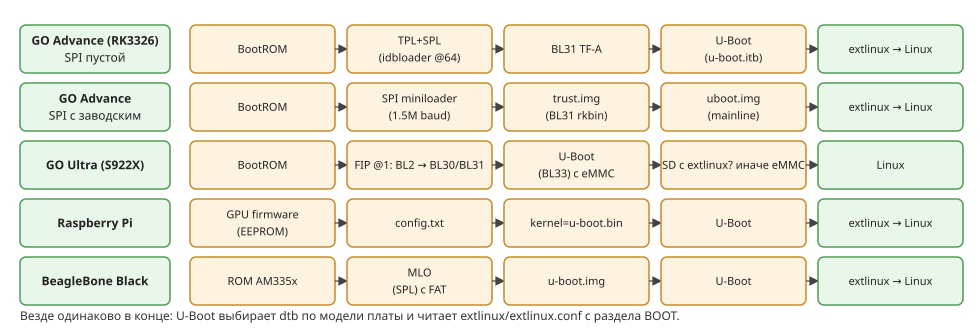
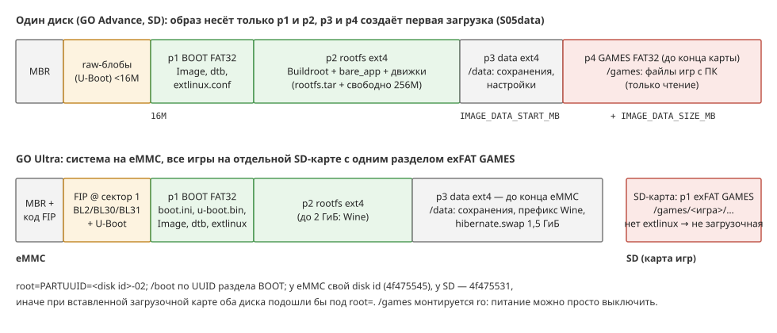

# 2. Загрузка и разметка дисков

## Цепочки загрузки

Общее для всех плат: U-Boot определяет модель, выбирает dtb и читает
`extlinux/extlinux.conf` с раздела BOOT, а ядро монтирует корень по
`root=PARTUUID=<disk id>-02`. Отличается только то, как до U-Boot добирается
BootROM:

- **GO Advance (RK3326).** BootROM сначала смотрит в SPI-флеш. У Black Edition
  там с завода recovery-загрузчик Hardkernel (DDR-блоб + miniloader, лог на 1,5 Мбод,
  который CP2102 не читает), поэтому образ **гибридный** (`RK_LEGACY := y`): тот
  же mainline U-Boot упакован и как `u-boot.itb` для открытой цепочки TPL → SPL →
  TF-A, и как `uboot.img` + `trust.img` (BL31 из rkbin) для miniloader. Грузится
  и так, и так. Таблица разделов — MBR: GPT пересеклась бы с окружением U-Boot на 16K.
- **GO Ultra (S922X).** BootROM берёт загрузчик с сектора 1 сначала eMMC, потом
  SD. Образ несёт свой FIP: BL2/BL30/BL31 Amlogic (блобы LibreELEC, скачиваются при
  сборке — лицензия запрещает их класть в git) + mainline U-Boot как BL33. Пока на
  eMMC заводской загрузчик, он выполняет `boot.ini` с карты и чейнлоадит наш
  `u-boot.bin`. После записи нашего FIP на eMMC (`make flash-emmc`) U-Boot всегда
  идёт с eMMC, а Linux — с SD, если на ней есть `extlinux.conf`, иначе с eMMC.
- **Raspberry Pi** — прошивка GPU читает `config.txt` и запускает `u-boot.bin`.
- **BeagleBone Black** — ROM → `MLO` → `u-boot.img` с FAT.

Подробности каждой платы — [8. Платы](08-Boards.md).

## Разметка дисков

Образ (`make image`) содержит только MBR, raw-блобы загрузчика, **p1 BOOT**
(FAT32: ядро, dtb, extlinux) и **p2 rootfs** (ext4). Разделов данных в образе
нет — их создаёт при первой загрузке `/etc/init.d/S05data`
(`board/common/buildroot/rootfs-overlay`):

| Раздел | Метка | Где | Для чего |
|---|---|---|---|
| p3 ext4 | `data` | `/data` | всё, что пишется на плате: сохранения, настройки, префикс Wine, журналы, файл гибернации |
| p4 FAT32 | `GAMES` | `/games` | файлы игр, скопированные с ПК; только если задан `IMAGE_DATA_SIZE_MB` |

Начало p3 задаёт `IMAGE_DATA_START_MB`, конец — `IMAGE_DATA_SIZE_MB` (или конец
диска). rootfs должен кончаться раньше — это проверяет `mkimage.sh`. После
`make flash` в таблице снова только p1 и p2, но скрипт находит на прежних местах
файловые системы `data` и `GAMES` и подключает их без форматирования: **оба
раздела переживают перепрошивку**. Раздел с другой ФС скрипт не трогает.

### Две схемы

- **GO Advance** — всё на одной SD: p3 `data` 1 ГБ с 4096 МиБ, p4 `GAMES` до конца.
- **GO Ultra** — система и `/data` на eMMC (p3 до конца eMMC, раздела игр нет),
  **все игры на отдельной SD-карте с одним разделом exFAT `GAMES`**. На карте нет
  `extlinux.conf`, поэтому U-Boot её пропускает и грузит систему с eMMC, а
  `S05data` монтирует её на `/games`. Карту можно менять; вставленная после
  загрузки подключится после перезагрузки.

Форматирование карты игр (Linux): `sudo mkfs.exfat -c 32K -L GAMES /dev/sdX1` —
кластер 32 КиБ вместо 128 по умолчанию, мелких файлов у игр много. Windows и
macOS: обычный exFAT с меткой `GAMES`. FAT32 тоже подходит, но файлы больше 4 ГБ
туда не лягут (у DOOM 3 BFG ресурсы большие).

### Когда разделов игр два

Если у платы есть и свой p4, и карта, их объединяет `/usr/sbin/games-mount`:
разделы монтируются в `/run/games/0` и `/run/games/1`, а `/games` — tmpfs из
символических ссылок. Каталог, который есть в обоих, становится настоящим
каталогом с файлами обоих (так карта может добавить `base/maps` к DOOM 3 на
eMMC); при совпадении имён берётся файл первого. overlayfs не подходит: он не
принимает FAT и exFAT. Имена сравниваются без регистра, как на FAT.

### `/games` только для чтения

`/games` всегда монтируется ro, чтобы выключение питания не оставляло FAT
«грязной». Писать с платы: `games-mount rw`, потом `games-mount ro`
(карту — `mount -o remount,rw /run/games/1`). Игры этого не знают: сохранения у
них идут в `/data`, а Wine-игры, пишущие в свой каталог, получают копию
(`writable` в `wine.ini`, см. [4. Игры](04-Games.md)).

## USB-диск

Без извлечения карты раздел игр можно открыть компьютеру по USB-C:
`/usr/sbin/usb-disk start` отмонтирует `/games` и добавляет к работающему
USB-гаджету (`S42usbnet`, сеть остаётся) функцию mass storage; компьютер видит
съёмный диск `GAMES`. `usb-disk status` замечает, что компьютер извлёк диск,
`usb-disk stop` проверяет ФС (`fsck.exfat -p` / `fsck.fat -a`) и монтирует обратно.
В bare_app это экран «USB-диск» (GO Ultra): раздел открыт, пока открыт экран, и
возвращается сам после извлечения на компьютере. Запись ~11 МБ/с, поэтому для
больших игр быстрее картридер. «Выключить» в «Дисках» GNOME отключает всё
USB-устройство вместе с сетью — тогда B дважды на приставке.

## Сеть по USB-C (GO Ultra)

`S42usbnet` делает из порта сетевую карту (NCM): приставка — `192.168.7.2`,
компьютер получает `192.168.7.1` по DHCP без шлюза. Дальше `ssh root@192.168.7.2`
по ключу из `board/common/buildroot/authorized_keys` (файл не в git: положите
свой открытый ключ до `make rootfs`; у root нет пароля, и dropbear без ключа не
пустит). Ключ хоста dropbear создаётся заново после каждой записи образа.
`scripts/ogu-ctl.py` ходит по этой сети.

Несколько приставок с одним образом различаются по серийному номеру eMMC
(`/usr/sbin/unit serial`): строка в `board/ogu/buildroot/rootfs-overlay/etc/units`
даёт приставке своё имя хоста (`S00unit`) и свою подсеть — например, `ogu2` на
`192.168.8.2` (компьютер — `192.168.8.1`, свой MAC, интерфейс `enx024f47550101`).
Так две приставки можно подключить к одному компьютеру сразу. Приставка, которой
нет в таблице, — `odroid-go-ultra` на `192.168.7.2`. Скрипты на ПК выбирают
приставку через `OGU_HOST=192.168.8.2`.

## Первая загрузка

1. `S05data` создаёт `/data` (и `/games` там, где он на том же диске), находит карту игр.
2. `S03mdev` в фоне грузит модули; `S30audio` (GO Ultra) ставит маршрут DPCM звуковой карты;
   `S31clock` берёт время из RTC RK818; `S06hibernate` готовит файл гибернации.
3. `S<INIT_ORDER>bare-app` запускает лаунчер: на GO Advance `S06` — сразу после
   данных, до сети (Wi-Fi подхватится позже); на GO Ultra `S90`.

До меню bare_app: ~3,7 с на GO Ultra, ~5 с на GO Advance (раздел «Быстрая загрузка»
в [8. Платы](08-Boards.md)).
