# 3. bare_app — лаунчер

`apps/bare_app` — отдельный репозиторий (сабмодуль SDK), GUI-приложение на LVGL
9.6 с DRM-слоями, кнопками, стиками, батареей, подсветкой, Wi-Fi, трансляцией
экрана. Оно берёт экран сразу после загрузки и не закрывается: выключение —
удержание кнопки питания, короткое нажатие — сон или гибернация.

## Цели и границы

1. Новая плата или новое оборудование добавляются без переделки остального кода.
2. LVGL отвечает только за отрисовку и может быть заменён.
3. Игры — отдельные процессы со своими лицензиями; в `bare_app` не линкуется ничего GPL.

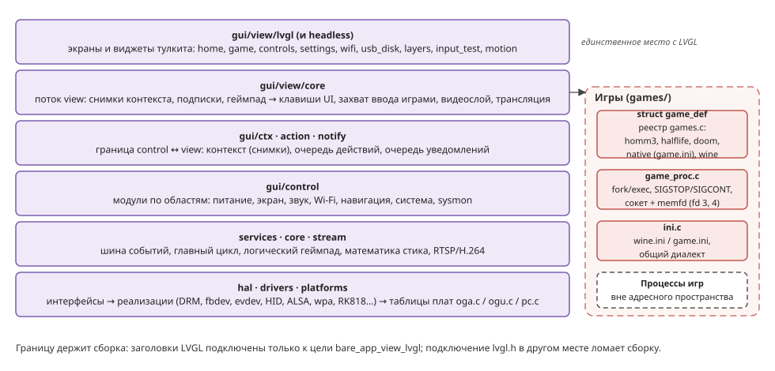

Границу с тулкитом держит сборка: путь к заголовкам LVGL подключён только к цели
`bare_app_view_lvgl`; бэкенд `headless` собирается вообще без тулкита и служит
проверкой. Платформа (`src/platforms/oga.c`, `ogu.c`, `pc.c`) выбирается во время
работы по `compatible` device tree, так что одна сборка может нести обе приставки.

## Потоки

| Поток | Владеет | Ждёт |
|---|---|---|
| control (main) | сервисы, шина, control-модули, запись в контекст | signalfd, очередь шины, очередь действий, таймеры |
| view | LVGL, драйверы экрана и ввода, видеослой | eventfd контекста, очередь notify, evdev, DRM, ящик кадров |
| звук интерфейса | PCM, пока звучит | очередь запросов |
| сеть трансляции | RTSP-сервер, кодер, зрители | сокеты, ящик кадров, RTCP |
| звук трансляции | захват loopback и вывод на устройство | PCM по 10 мс |
| процесс игры | движок, буфер в общей памяти | свой цикл |

Между потоками пять общих объектов: контекст `gui_ctx` (view читает только
снимки), очередь действий view → control, очередь уведомлений control → view,
шина событий сервисы → control, ящик кадров источник → view. Сигналы
принимаются через `signalfd` в control.

## Главный экран

Как у Switch: ряд крупных квадратных плиток — 10 игр по порядку последних
запусков, последняя плитка «Все игры» открывает библиотеку (сетка 5 в ряд на GO
Ultra, вертикальная прокрутка). Над рядом — название выбранной игры, под ним —
круглые кнопки экранов (тест ввода, USB-диск, файлы, настройки, слои или
стенд-тест), внизу — что сделают X и A. Сверху: часы (если выставлены), USB,
громкость, Wi-Fi, батарея с процентом (жёлтая с 20 %, красные цифры с 10 %, зелёная
с молнией на зарядке). Значки — на равных расстояниях; громкость нарисована как у GNOME
(Yaru): громкоговоритель и две дуги, белые по уровню, без звука всё серое и перечёркнуто
чертой с зазором; смена уровня ничего не сдвигает.

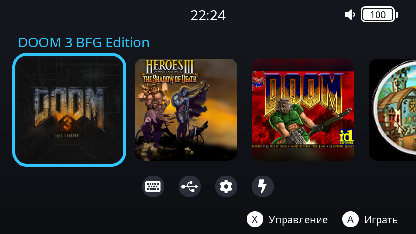
*Главный экран: ряд плиток по последним запускам, круглые кнопки экранов, подсказка кнопок внизу.*


*Конец ряда — плитка «Все игры»…*


*…и библиотека: все игры сеткой 5 в ряд с вертикальной прокруткой.*

- **Плитка** показывает `cover.png` из каталога игры (квадрат любого размера,
  обрезается по плитке 210×210 на GO Ultra, 140×140 на OGA); без обложки —
  название на цветном фоне, свёрнутая — со значком паузы.
- **Только то, что есть на карте**: игры без нужных файлов (`missing()`) в меню не
  показываются. Пока открыт главный экран или библиотека, bare_app раз в 2 секунды
  сверяет каталоги, откуда берутся игры (`watch()` каждого типа игры: смонтирован
  ли, та же ли ФС, те же ли имена), и при изменении строит экран заново: вставили
  или вынули карту, скопировали игру — меню это покажет. Описания игр (`wine.ini`,
  `game.ini`) лежат на карте, так что для нового списка игр rootfs не нужен.
- **A** запускает, **X** открывает «Управление игры», **B** в библиотеке возвращает на главный.
- Порядок хранится в файле настроек (`recent=` до 16 ключей игр). Ключ игры —
  8 hex-цифр от её id и имени каталога, поэтому переименование каталога игры
  теряет её порядок и настройки управления.

### Экран «Управление игры»

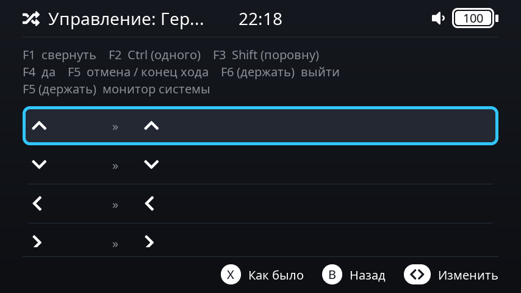
*X на плитке Героев III: сверху подсказка игры, ниже строка на каждую кнопку и во что она превращается.*

Строка на каждую кнопку устройства, которую получает игра, справа — какой кнопкой
она будет для игры; слева/справа перебирают, X возвращает, последняя строка —
всё как было. Сверху — подсказка игры (`hint`), в строках — что кнопка делает в
игре (`[labels]` / `[labels.ru]` из ini; у Doom и Героев III — по их раскладке, у
Героев своя для GO Advance и GO Ultra; у Half-Life — что привязано к кнопке в
`config.cfg` игры, `label()` в `game_def` получает платформу). Ниже — инверсия осей стиков, а с
датчиком движения — «Прицел гироскопом» и чувствительность. Хранится по игре:
`controls.<ключ>=a=b,x=-,ly=invert,gyro=on`. Кнопки, которые bare_app оставляет
себе (питание, громкость, F6, кнопка сворачивания, L2/R2 там, где они —
громкость), в списке нет. Изменения действуют со следующего нажатия, даже в
свёрнутой игре.

Y на плитке — **опции** игры. Пока одна — **предел кадров**: 20, 30, 35, 40, 50,
60 FPS или «Выкл.»; X — рекомендованный для игры. У каждой игры он свой (не меньше
30): `fps_limit` в `wine.ini` / `game.ini` или в `game_def` встроенных игр —
30 у NFSU, Pirates!, Prince of Persia, Daemonica, Monkey Island, Fallout, HotA,
Neighbours и Героев III; 35 у Doom и Chocolate Doom (их такты); 60 у Shade,
Knights of the Temple, DOOM 3, RTCW и Half-Life. Выбранное другое хранится как
`options.<ключ>=fps=40` (`fps=0` — без предела). Игра не делает кадров чаще:
ровнее на экране 60 Гц, меньше нагрев и расход батареи. Действует сразу.
Ждёт сама игра перед кадром (`frame_us` в общей памяти); у Windows-игр — GL-swap
winebare.drv.

## Файловый менеджер

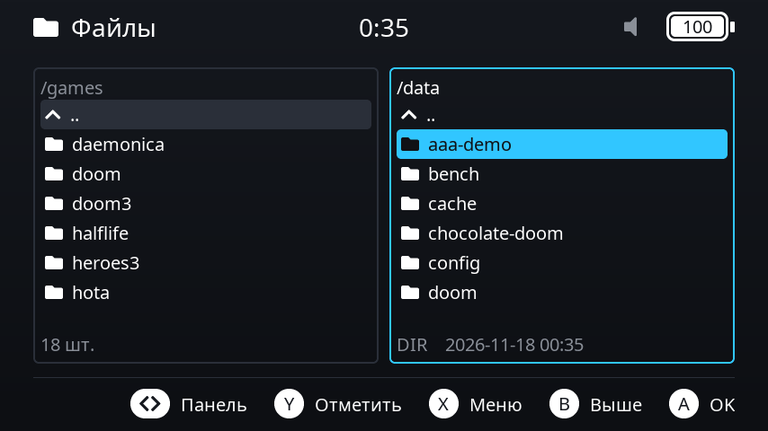
*Две панели: слева `/games`, справа `/data`; горит панель с курсором, внизу — размер и время или сколько отмечено.*

Круглая кнопка с папкой (`SCREEN_FILES`): две панели, как в Midnight Commander.
Вверх/вниз — курсор (L1/R1 — страница), влево/вправо — другая панель, A — войти в
каталог или открыть файл в редакторе, B — каталог выше (в `/` — закрыть), Y —
отметить, X — меню.

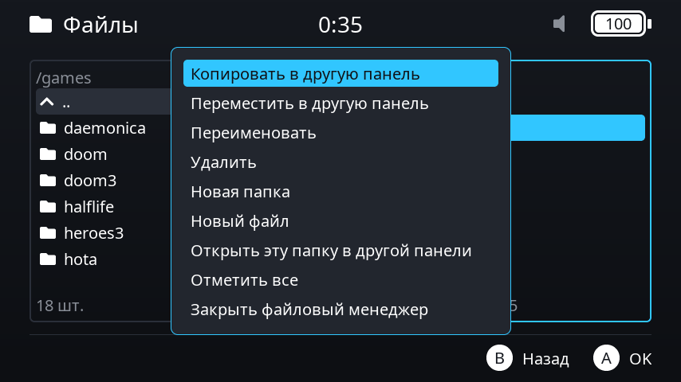
*X: копировать или перенести в другую панель, переименовать, удалить, новая папка и файл, отметить все.*

Копирование, перенос и удаление берут отмеченные записи (или ту, что под курсором),
спрашивают перед удалением и перед заменой того, что уже есть. Их выполняет control
(`ctl_files`, `services/files.c`) в отдельном потоке; окно показывает ход, B
отменяет. Панели рисуют только видимые строки и перечитывают каталог, когда он
меняется. На `/games` (смонтирован только для чтения) запись не пройдёт — экран так и
скажет; для записи: `mount -o remount,rw /games`.

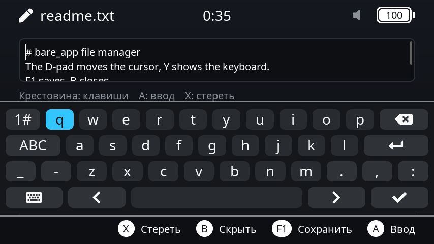
*Редактор: Y — экранная клавиатура (крестовина ходит по клавишам, A печатает, X стирает), F1 сохраняет.*

Редактор — для текстов до 128 КБ: крестовина двигает курсор, A — перевод строки, X
стирает, Y — экранная клавиатура, F1 сохраняет (новый файл рядом и переименование
поверх старого), B закрывает и спросит про несохранённое. USB-клавиатура печатает и в
редакторе, и в именах (раскладка US, Ctrl+S, Esc, Home/End, PgUp/PgDn).

## Диспетчер задач

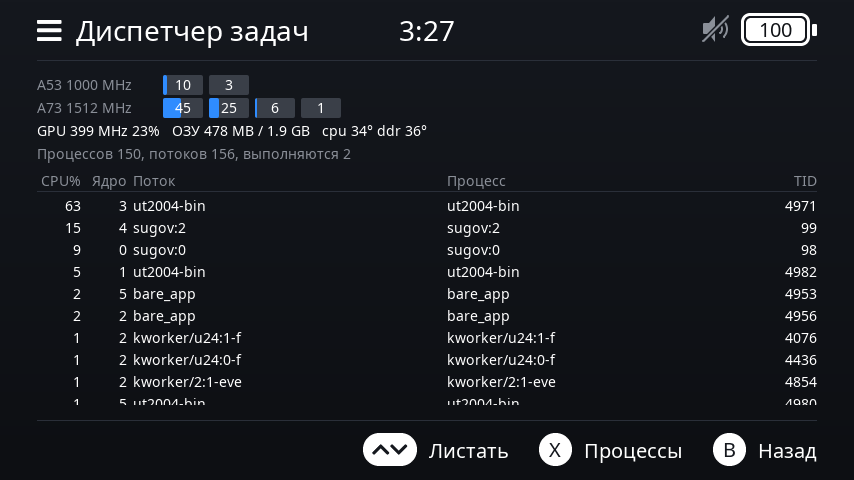
*Свёрнутая UT2004 в матче: главный поток игры занимает 63% ядра A73, GPU загружен на 23%.*

Круглая кнопка ≡ (`SCREEN_TASKS`). Сверху — по строке на кластер ядер (загрузка
каждого ядра полоской, частота кластера), частота и загрузка GPU, память и своп,
температуры, сколько процессов и потоков. Ниже — таблица самых занятых потоков: доля
одного ядра, ядро, на котором поток шёл последним, его процесс, TID. X переключает на
процессы: CPU, GPU, память, число потоков. Вверх/вниз листают (L1/R1 — страница), B —
назад. Только смотрит, ничего не останавливает.

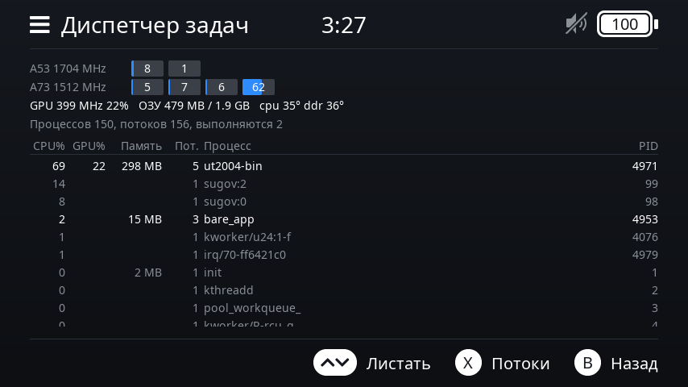
*X: процессы. GPU% — время работы GPU на клиента DRM.*

Во время игры: F5 сворачивает её, потом ≡ на главном экране. Свёрнутая игра обычно
стоит на SIGSTOP, но пока открыт диспетчер, она идёт дальше (без картинки и кнопок),
чтобы была видна её нагрузка; B — снова пауза. Данные раз в секунду читает `ctl_tasks`
(`services/tasks.c`: `/proc/<pid>/task/<tid>/stat`; GPU — `drm-engine-*` в fdinfo
файлов `/dev/dri` процессов, panfrost считает это время, только пока включён его
`profiling`: диспетчер включает его на время показа и возвращает как было).

## Игры как отдельные процессы

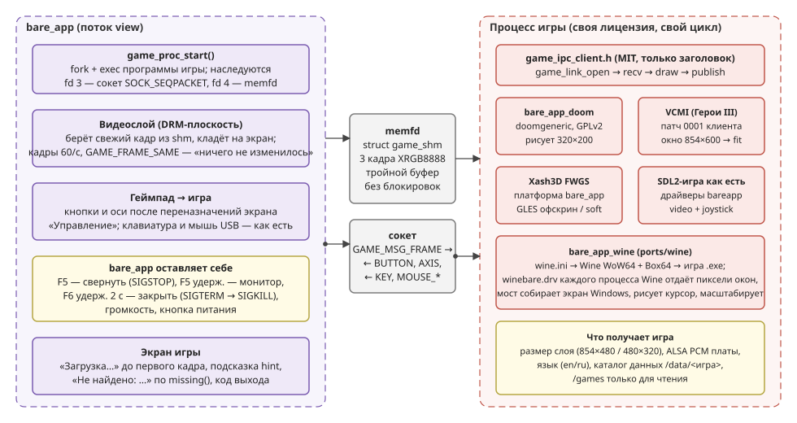

Каждая игра — программа, которую bare_app запускает на сеанс
(`src/games/game_proc.c`): `fork` + `exec` с двумя унаследованными дескрипторами.

- **fd 3** — сокет `SOCK_SEQPACKET`, по пакету `struct game_msg`: игра → приложение
  `GAME_MSG_FRAME` (с флагом `GAME_FRAME_SAME`, если кадр не изменился: так
  неподвижная картинка не принимается за зависание); приложение → игра
  `GAME_MSG_BUTTON`, `GAME_MSG_AXIS`, а играм с клавиатурой и мышью USB —
  `GAME_MSG_KEY`, `GAME_MSG_MOUSE_*`. EOF — другая сторона умерла.
- **fd 4** — memfd: `struct game_shm` и три кадра XRGB8888 размером с видеослой.
  Тройной буфер без блокировок: у каждого по буферу, третий «в середине»; игра,
  упавшая посреди кадра, не блокирует приложение. Для трансляции игра может
  отдавать ещё и «свою картинку» большего размера (VCMI 854×600 → поток).
  Там же `frame_us` — предел кадров из опций игры: приложение пишет его в любой
  момент, игра перед каждым кадром ждёт `game_shm_pace()` (это делают
  `game_link_publish()` и `game_link_same()`).

Протокол — `src/games/game_ipc.h`, сторона игры — `game_ipc_client.h`, оба под
MIT, чтобы включаться в игры с любой лицензией; Buildroot кладёт их в
`staging/usr/include/bare_app/`. Кадр уже должен быть размера слоя:
масштабирует игра (или драйвер SDL2 / мост Wine).

Что получает процесс игры: размер слоя (854×480 на GO Ultra, 480×320 на OGA),
ALSA-устройство платы (при включённой трансляции — сторона loopback), язык
(`en`/`ru`), каталог данных. Вывод игры попадает в журнал запуска
`/data/logs/<игра>/1.log` (`2.log`, `3.log` — прежние запуски): со временем каждой
строки, с тем, что было запущено, кодом выхода или сигналом и сообщениями ядра за время
игры.

### Жизненный цикл

| Событие | Что делает bare_app |
|---|---|
| запуск | экран «Загрузка…» до первого кадра, потом подсказка `hint` на пару секунд |
| F5 (у Героев на GO Ultra — F1) | сворачивает: процессу SIGSTOP, в меню значок паузы; та же кнопка или плитка разворачивают с того же места |
| F5 удерживать 0,6 с | монитор системы поверх игры (CPU по кластерам, GPU, память, температуры, батарея, диски, FPS и график времени кадра) |
| F6 удерживать 2 с | SIGTERM (SDL превращает в `SDL_QUIT`), через секунду SIGKILL, назад в меню |
| L2/R2 | громкость у игр с `trigger_volume` / `volume = triggers`, иначе уходят в игру |
| выход с кодом 0 | экран закрывается; другой код или сигнал — экран показывает причину |
| пункт другой игры при свёрнутой | вопрос: закрыть свёрнутую или отменить |
| заряд ≤ 15 % без зарядки | красное предупреждение на 6 с, с 5 % — батарея в углу |

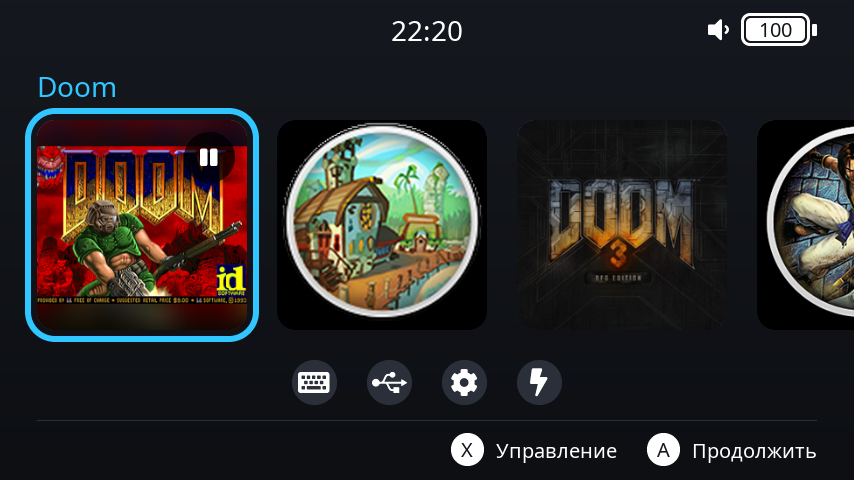
*Doom свёрнут по F5: процесс остановлен, на плитке значок паузы, A продолжает с того же места.*

## Реестр игр

Меню, экран игры и ядро view знают игры только через таблицу `games[]` в
`src/games/games.c` — по одному `struct game_def` на тип игры
(`homm3.c`, `halflife.c`, `doom.c`, `native.c`, `wine.c`; `bench.c` — стенд-тест
отдельной круглой кнопкой). Поля: `id`, `title`, `hint`, `missing()` (что не
найдено), `start()` (запуск), `entries()`/`info()` для игр, найденных во время
работы (каждый `wine.ini` и `game.ini` — отдельный пункт), `watch()` (каталоги,
изменение которых меняет меню), `label()` для экрана управления, `trigger_volume`,
`gyro_on`, `hint_for()`/`minimize_for()` по платформе. `switch` по играм в коде нет.

## Состав сборки (Kconfig)

Что входит в бинарник — платформы, драйверы, экраны, шрифты, языки, игры —
задаёт собственный `Kconfig` (Kconfiglib в `tools/kconfig`): `configs/pc_defconfig`
(симулятор SDL, тесты), `oga_defconfig`, `ogu_defconfig`, `oga_minimal_defconfig`.
В образе символы игр ставит пакет `bare-app` из `APPS_CONFIG`
(`CONFIG_GAME_HOMM3=$(…BR2_PACKAGE_BARE_APP_HOMM3)` и т. д.), так что игра
включается в одном месте — конфиге прошивки.

```sh
cmake -S . -B build-host && cmake --build build-host -j && (cd build-host && ctest)
./build-host/bare_app                                    # симулятор в окне SDL
echo "down a wait:500 f6" | BARE_APP_SHOT=s.ppm ./build-host/bare_app -p pc-mem   # сценарий + снимок
BARE_APP_SIZE=854x480 ./build-host/bare_app -p pc-mem    # экран GO Ultra
```

## Остальные экраны и сервисы

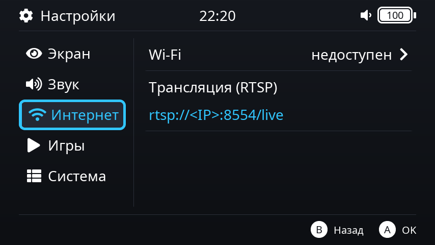
*Настройки, категория «Интернет»: Wi-Fi (на GO Ultra — через USB-адаптер) и адрес RTSP-трансляции.*


*Тест ввода: только те кнопки и оси, которые объявили драйверы платы; A×2 — калибровка стиков.*

- **Настройки**: язык (en/ru), яркость, громкость, Wi-Fi (список сетей, ввод ключа
  `lv_keyboard`), интернет (RTSP-трансляция), система (гибернация, дата и время,
  частота GPU, предел заряда), датчик движения.
- **Трансляция (RTSP)** — свой сервер без сторонних библиотек: H.264 (аппаратный
  кодер через V4L2 — `meson-venc` на GO Ultra, `rk-vepu-h264` на OGA, иначе OpenH264),
  звук L16 через ALSA loopback, MPEG-TS для VLC без live555.
  `rtsp://<адрес>:8554/live`.
- **Монитор системы** — `services/sysmon.c`, читает `/proc` и `/sys`, всегда по-английски.
- **Снимок экрана** — `kill -USR1` → слои дисплея в PPM (`BARE_APP_SHOT`),
  `ogu-ctl.py shot:` / `oga.sh shot`.
- **Клавиатура и мышь USB** — захватываются (`input_hid`), в меню работают как кнопки,
  в Windows-игры и SDL-игры идут как есть.
- **Датчик движения** (ICM-20948 на USB) — гироскоп как мышь: по умолчанию включён у
  Doom, Half-Life, DOOM 3, RTCW, выключен у игр с курсором.

Подробности до уровня файлов — [ARCHITECTURE.md](../../apps/bare_app/docs/ARCHITECTURE.md);
кнопки каждой игры — [README.md](../../apps/bare_app/README.md).
