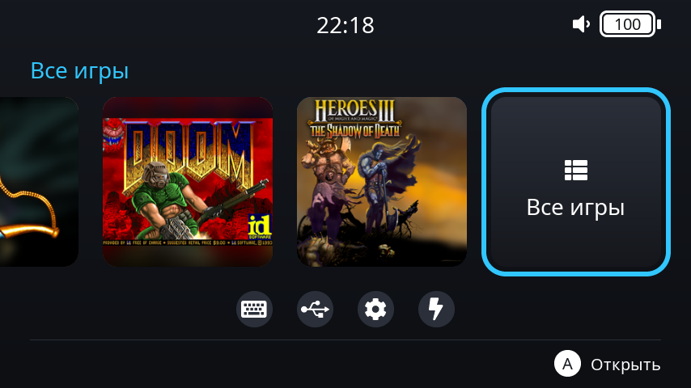
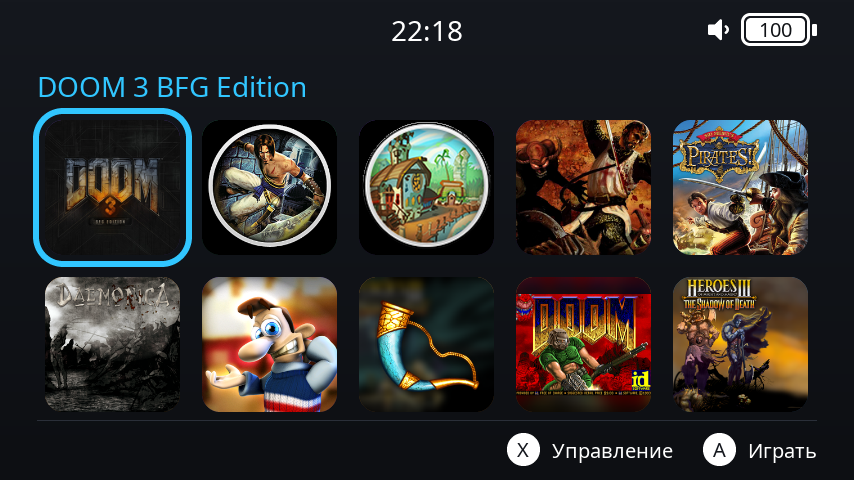
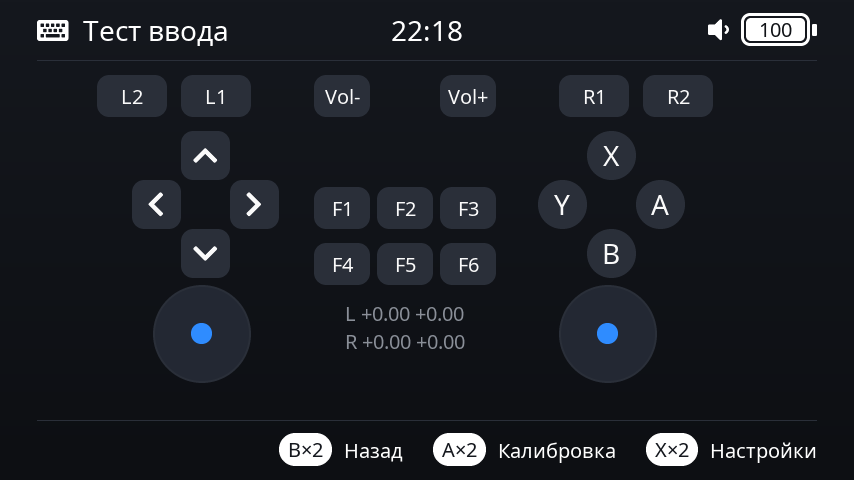

# 3. bare_app — лаунчер

`apps/bare_app` — отдельный репозиторий (сабмодуль SDK), GUI-приложение на LVGL
9.6 с DRM-слоями, кнопками, стиками, батареей, подсветкой, Wi-Fi, трансляцией
экрана. Оно берёт экран сразу после загрузки и не закрывается: выключение —
удержание кнопки питания, короткое нажатие — сон или гибернация.

## Цели и границы

1. Новая плата или новое оборудование добавляются без переделки остального кода.
2. LVGL отвечает только за отрисовку и может быть заменён.
3. Игры — отдельные процессы со своими лицензиями; в `bare_app` не линкуется ничего GPL.


Границу с тулкитом держит сборка: путь к заголовкам LVGL подключён только к цели
`bare_app_view_lvgl`; бэкенд `headless` собирается вообще без тулкита и служит
проверкой. Платформа (`src/platforms/oga.c`, `ogu.c`, `pc.c`) выбирается во время
работы по `compatible` device tree, так что одна сборка может нести обе приставки.

## Потоки

| Поток | Владеет | Ждёт |
|---|---|---|
| control (main) | сервисы, шина, control-модули, запись в контекст | signalfd, очередь шины, очередь действий, таймеры |
| view | LVGL, драйверы экрана и ввода, видеослой | eventfd контекста, очередь notify, evdev, DRM, ящик кадров |
| звук интерфейса | PCM, пока звучит | очередь запросов |
| сеть трансляции | RTSP-сервер, кодер, зрители | сокеты, ящик кадров, RTCP |
| звук трансляции | захват loopback и вывод на устройство | PCM по 10 мс |
| процесс игры | движок, буфер в общей памяти | свой цикл |

Между потоками пять общих объектов: контекст `gui_ctx` (view читает только
снимки), очередь действий view → control, очередь уведомлений control → view,
шина событий сервисы → control, ящик кадров источник → view. Сигналы
принимаются через `signalfd` в control.

## Главный экран

Как у Switch: ряд крупных квадратных плиток — 10 игр по порядку последних
запусков, последняя плитка «Все игры» открывает библиотеку (сетка 5 в ряд на GO
Ultra, вертикальная прокрутка). Над рядом — название выбранной игры, под ним —
круглые кнопки экранов (тест ввода, USB-диск, настройки, слои или стенд-тест),
внизу — что сделают X и A. Сверху: часы (если выставлены), громкость, Wi-Fi,
батарея с процентом (жёлтая с 20 %, красные цифры с 10 %, зелёная с молнией на зарядке).


*Главный экран: ряд плиток по последним запускам, круглые кнопки экранов, подсказка кнопок внизу.*


*Конец ряда — плитка «Все игры»…*


*…и библиотека: все игры сеткой 5 в ряд с вертикальной прокруткой.*

- **Плитка** показывает `cover.png` из каталога игры (квадрат любого размера,
  обрезается по плитке 210×210 на GO Ultra, 140×140 на OGA); без обложки —
  название на цветном фоне. Игра без нужных файлов затемнена с пометкой «не
  установлена», свёрнутая — со значком паузы.
- **A** запускает, **X** открывает «Управление игры», **B** в библиотеке возвращает на главный.
- Порядок хранится в файле настроек (`recent=` до 16 ключей игр). Ключ игры —
  8 hex-цифр от её id и имени каталога, поэтому переименование каталога игры
  теряет её порядок и настройки управления.

### Экран «Управление игры»


*X на плитке Героев III: сверху подсказка игры, ниже строка на каждую кнопку и во что она превращается.*

Строка на каждую кнопку устройства, которую получает игра, справа — какой кнопкой
она будет для игры; слева/справа перебирают, X возвращает, последняя строка —
всё как было. Сверху — подсказка игры (`hint`), в строках — что кнопка делает в
игре (`[labels]` / `[labels.ru]` из ini). Ниже — инверсия осей стиков, а с
датчиком движения — «Прицел гироскопом» и чувствительность. Хранится по игре:
`controls.<ключ>=a=b,x=-,ly=invert,gyro=on`. Кнопки, которые bare_app оставляет
себе (питание, громкость, F6, кнопка сворачивания, L2/R2 там, где они —
громкость), в списке нет. Изменения действуют со следующего нажатия, даже в
свёрнутой игре.

## Игры как отдельные процессы


Каждая игра — программа, которую bare_app запускает на сеанс
(`src/games/game_proc.c`): `fork` + `exec` с двумя унаследованными дескрипторами.

- **fd 3** — сокет `SOCK_SEQPACKET`, по пакету `struct game_msg`: игра → приложение
  `GAME_MSG_FRAME` (с флагом `GAME_FRAME_SAME`, если кадр не изменился: так
  неподвижная картинка не принимается за зависание); приложение → игра
  `GAME_MSG_BUTTON`, `GAME_MSG_AXIS`, а играм с клавиатурой и мышью USB —
  `GAME_MSG_KEY`, `GAME_MSG_MOUSE_*`. EOF — другая сторона умерла.
- **fd 4** — memfd: `struct game_shm` и три кадра XRGB8888 размером с видеослой.
  Тройной буфер без блокировок: у каждого по буферу, третий «в середине»; игра,
  упавшая посреди кадра, не блокирует приложение. Для трансляции игра может
  отдавать ещё и «свою картинку» большего размера (VCMI 854×600 → поток).

Протокол — `src/games/game_ipc.h`, сторона игры — `game_ipc_client.h`, оба под
MIT, чтобы включаться в игры с любой лицензией; Buildroot кладёт их в
`staging/usr/include/bare_app/`. Кадр уже должен быть размера слоя:
масштабирует игра (или драйвер SDL2 / мост Wine).

Что получает процесс игры: размер слоя (854×480 на GO Ultra, 480×320 на OGA),
ALSA-устройство платы (при включённой трансляции — сторона loopback), язык
(`en`/`ru`), каталог данных. Вывод игры попадает в `/var/log/bare_app.log`.

### Жизненный цикл

| Событие | Что делает bare_app |
|---|---|
| запуск | экран «Загрузка…» до первого кадра, потом подсказка `hint` на пару секунд |
| F5 (у Героев на GO Ultra — F1) | сворачивает: процессу SIGSTOP, в меню значок паузы; та же кнопка или плитка разворачивают с того же места |
| F5 удерживать 0,6 с | монитор системы поверх игры (CPU по кластерам, GPU, память, температуры, батарея, диски, FPS и график времени кадра) |
| F6 удерживать 2 с | SIGTERM (SDL превращает в `SDL_QUIT`), через секунду SIGKILL, назад в меню |
| L2/R2 | громкость у игр с `trigger_volume` / `volume = triggers`, иначе уходят в игру |
| выход с кодом 0 | экран закрывается; другой код или сигнал — экран показывает причину |
| пункт другой игры при свёрнутой | вопрос: закрыть свёрнутую или отменить |
| заряд ≤ 15 % без зарядки | красное предупреждение на 6 с, с 5 % — батарея в углу |


*Doom свёрнут по F5: процесс остановлен, на плитке значок паузы, A продолжает с того же места.*

## Реестр игр

Меню, экран игры и ядро view знают игры только через таблицу `games[]` в
`src/games/games.c` — по одному `struct game_def` на тип игры
(`homm3.c`, `halflife.c`, `doom.c`, `native.c`, `wine.c`; `bench.c` — стенд-тест
отдельной круглой кнопкой). Поля: `id`, `title`, `hint`, `missing()` (что не
найдено), `start()` (запуск), `entries()`/`info()` для игр, найденных во время
работы (каждый `wine.ini` и `game.ini` — отдельный пункт), `label()` для экрана
управления, `trigger_volume`, `gyro_on`, `hint_for()`/`minimize_for()` по
платформе. `switch` по играм в коде нет.

## Состав сборки (Kconfig)

Что входит в бинарник — платформы, драйверы, экраны, шрифты, языки, игры —
задаёт собственный `Kconfig` (Kconfiglib в `tools/kconfig`): `configs/pc_defconfig`
(симулятор SDL, тесты), `oga_defconfig`, `ogu_defconfig`, `oga_minimal_defconfig`.
В образе символы игр ставит пакет `bare-app` из `APPS_CONFIG`
(`CONFIG_GAME_HOMM3=$(…BR2_PACKAGE_BARE_APP_HOMM3)` и т. д.), так что игра
включается в одном месте — конфиге прошивки.

```sh
cmake -S . -B build-host && cmake --build build-host -j && (cd build-host && ctest)
./build-host/bare_app                                    # симулятор в окне SDL
echo "down a wait:500 f6" | BARE_APP_SHOT=s.ppm ./build-host/bare_app -p pc-mem   # сценарий + снимок
BARE_APP_SIZE=854x480 ./build-host/bare_app -p pc-mem    # экран GO Ultra
```

## Остальные экраны и сервисы


*Настройки, категория «Интернет»: Wi-Fi (на GO Ultra — через USB-адаптер) и адрес RTSP-трансляции.*


*Тест ввода: только те кнопки и оси, которые объявили драйверы платы; A×2 — калибровка стиков.*

- **Настройки**: язык (en/ru), яркость, громкость, Wi-Fi (список сетей, ввод ключа
  `lv_keyboard`), интернет (RTSP-трансляция), система (гибернация, дата и время),
  датчик движения.
- **Трансляция (RTSP)** — свой сервер без сторонних библиотек: H.264 (аппаратный
  кодер через V4L2 — `meson-venc` на GO Ultra, `rk-vepu-h264` на OGA, иначе OpenH264),
  звук L16 через ALSA loopback, MPEG-TS для VLC без live555.
  `rtsp://<адрес>:8554/live`.
- **Монитор системы** — `services/sysmon.c`, читает `/proc` и `/sys`, всегда по-английски.
- **Снимок экрана** — `kill -USR1` → слои дисплея в PPM (`BARE_APP_SHOT`),
  `ogu-ctl.py shot:` / `oga.sh shot`.
- **Клавиатура и мышь USB** — захватываются (`input_hid`), в меню работают как кнопки,
  в Windows-игры и SDL-игры идут как есть.
- **Датчик движения** (ICM-20948 на USB) — гироскоп как мышь: по умолчанию включён у
  Doom, Half-Life, DOOM 3, RTCW, выключен у игр с курсором.

Подробности до уровня файлов — [ARCHITECTURE.md](../../apps/bare_app/docs/ARCHITECTURE.md);
кнопки каждой игры — [README.md](../../apps/bare_app/README.md).
