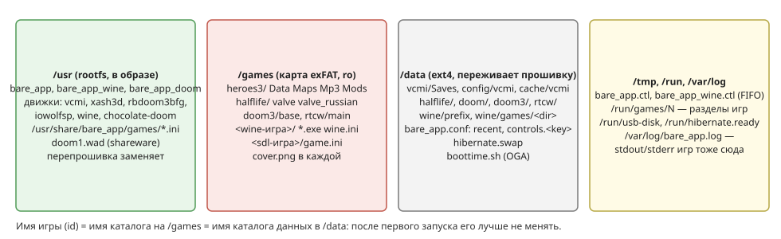
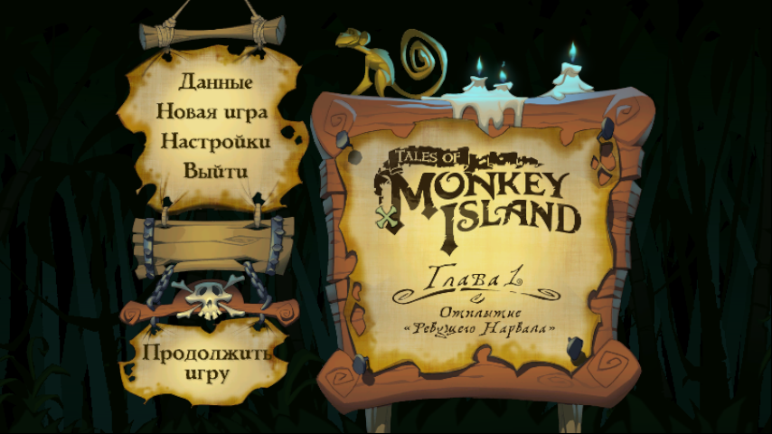
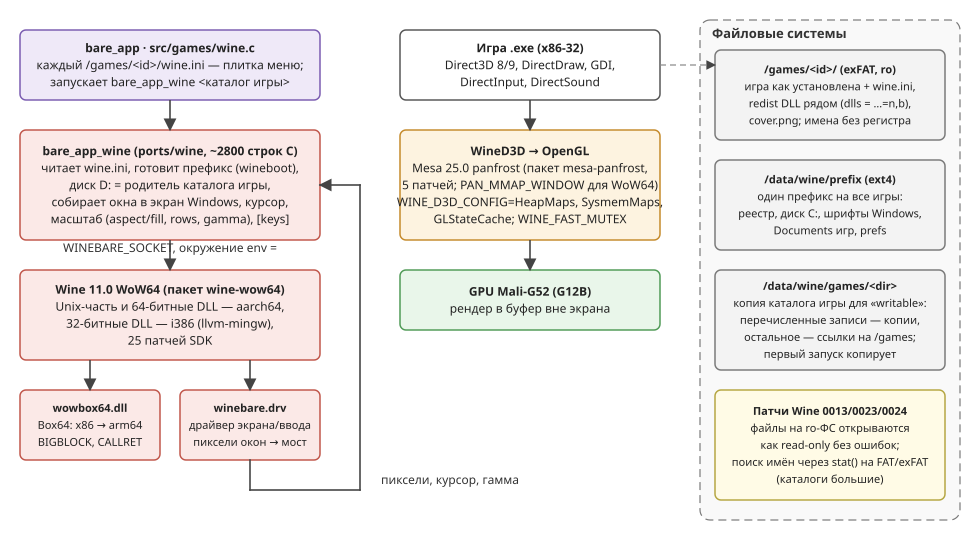
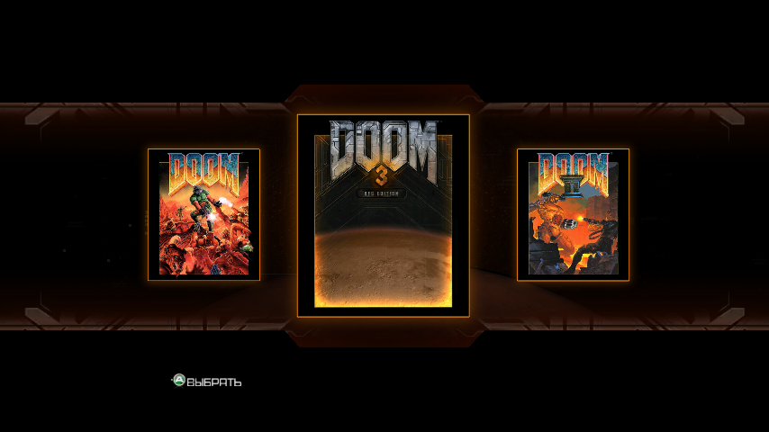
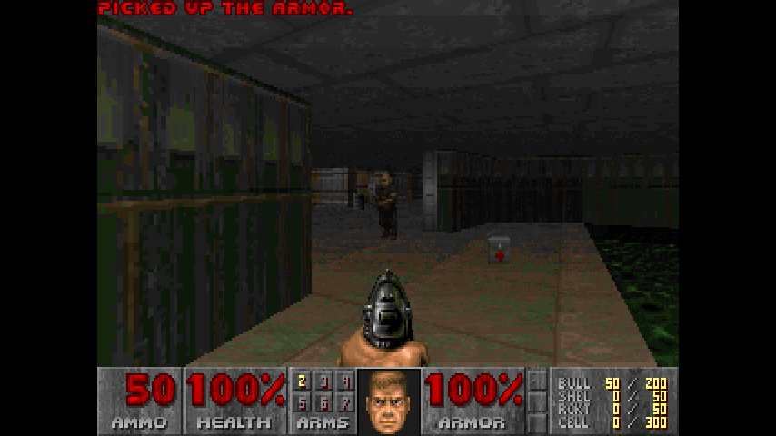
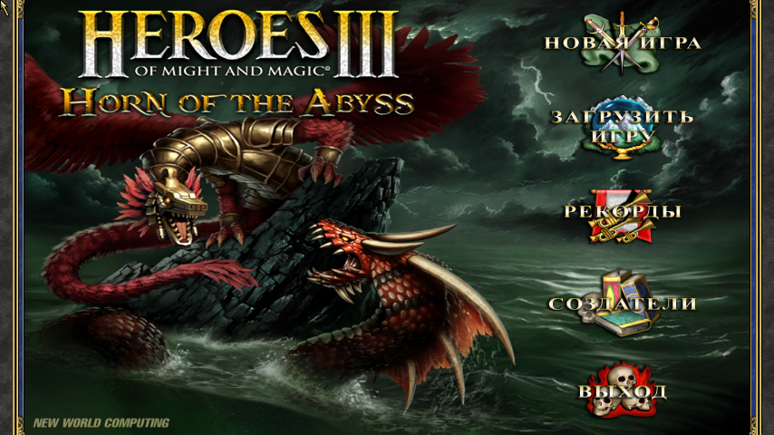

# 4. Игры: как устроены

## Три пути

Игры запускает bare_app; каждая — отдельный процесс, который отдаёт кадры и
получает геймпад по `game_ipc.h` ([3. bare_app](03-bare_app.md)). Как именно
игра добирается до этого протокола, зависит от того, на чём она написана:

| Путь | Для чего | Что связывает с bare_app | Код bare_app |
|---|---|---|---|
| **A. Windows-игра под Wine** (`wine.ini`) | x86-32 игры 1998–2010: D3D8/D3D9/DirectDraw, GDI | `bare_app_wine` (ports/wine) + драйвер `winebare.drv` внутри Wine | не меняется |
| **B. SDL2-игра** (`game.ini`) | Linux-порты на SDL2: RBDOOM-3-BFG, iortcw, Chocolate Doom, своя программа | SDL2 SDK с драйверами `bareapp` (video + joystick) | не меняется |
| **C. Свой движок** (`struct game_def`) | движок без SDL или с особым выводом: VCMI (лупа), Xash3D, Doom (doomgeneric) | патч движка с `game_ipc_client.h` + `src/games/<игра>.c` | один файл + строки |

Пути A и B — без единой строки кода в лаунчере. Текущие игры:

| Игра | Путь | Движок / пакет | Файлы на `/games` | Данные на `/data` |
|---|---|---|---|---|
| Герои III (heroes3) | C | VCMI 1.7.5, `vcmi` | `heroes3/Data Maps Mp3 Mods` | `vcmi/Saves`, `config/vcmi` |
| Half-Life | C | Xash3D FWGS + hlsdk-portable | `halflife/valve, valve_russian` | `halflife/` |
| Doom | C | doomgeneric (`bare_app_doom`) | `doom/*.wad` (иначе shareware из образа) | `doom/` |
| DOOM 3 BFG | B | RBDOOM-3-BFG, `rbdoom3-bfg` | `doom3/base` | `doom3/` |
| RTCW | B | iortcw, `iortcw` | `rtcw/main/*.pk3` | `rtcw/` |
| Chocolate Doom | B | пакет Buildroot (в ogu выключен) | — | `chocolate-doom/` |
| HotA, Pirates!, Daemonica, Tales of Monkey Island ×5, Knights of the Temple, Neighbours from Hell 1–2, Prince of Persia SoT | A | Wine 11.0 WoW64 + Box64 | `<id>/` с `wine.ini` | `wine/prefix`, `wine/games/<id>` |

## Где что лежит на плате



Правило трёх каталогов:

- **`/games/<id>`** — файлы игры, только чтение, с ПК по манифесту;
- **`/data/<id>`** — HOME игры: сохранения, настройки (Wine: общий префикс
  `/data/wine/prefix` и копии «writable» в `/data/wine/games/<id>`);
- **`cover.png`** в каталоге игры — обложка 240×240 для плитки.

`<id>` — имя каталога, оно же имя каталога данных, оно же входит в ключ настроек
управления. После первого запуска его лучше не менять.

## Путь A: Windows-игра под Wine


*Tales of Monkey Island (GOG, по-русски через строку `reg`) под Wine: режим 800×600, картинка 16:9 на весь экран (`rows = 360 60 640x480`).*



Каждый `/games/<id>/wine.ini` — плитка меню (`src/games/wine.c`). По A bare_app
запускает `bare_app_wine <каталог>` — мост на C (~2800 строк, `ports/wine`),
который:

1. читает `wine.ini` (образец со всеми ключами —
   [apps/bare_app/ports/wine/wine.ini](../../apps/bare_app/ports/wine/wine.ini));
2. готовит префикс `/data/wine/prefix` (первый запуск — `wineboot`, около минуты;
   префикс один на все игры), диск `D:` — родитель каталога игры;
3. если есть `writable`, делает копию каталога игры в `/data/wine/games/<id>`:
   перечисленные записи — настоящие копии, остальное — ссылки на `/games`;
4. применяет `reg` (ключи реестра, которые писал бы инсталлятор), `profile`
   (файлы в `C:\users\<user>`, только если их там ещё нет), `locale`, `dlls`
   (`WINEDLLOVERRIDES`), `env`;
5. запускает Wine с `WINEBARE_SOCKET`. `winebare.drv` (патч Wine 0003) в каждом
   процессе Wine подключается к мосту и отдаёт пиксели окон; мост собирает их в
   один экран Windows режима `mode`, рисует курсор, масштабирует в кадр
   (`scale = aspect|fill`, `rows`, `gamma`) и публикует;
6. превращает кнопки и стики в мышь и клавиатуру по `[keys]`.

Wine здесь — **WoW64**: Unix-часть и 64-битные DLL native aarch64, 32-битные
DLL — i386 (их собирает `llvm-mingw`), x86-код игры исполняет `wowbox64.dll`
(Box64). Direct3D идёт через WineD3D → OpenGL → Mesa panfrost → GPU Mali-G52.
Этот стек — 25 патчей Wine, 3 wowbox64 и 5 Mesa; самые важные для
производительности:

| Патч | Что | Зачем |
|---|---|---|
| Mesa 0005 `PAN_MMAP_WINDOW` | буферы GPU в окне 0x80000000–0xffffffff | WoW64 копировал GL-маппинги выше 4 ГиБ: Knights of the Temple 6 → 60 fps |
| Wine 0004/0011/0012/0018 `WINE_D3D_CONFIG=HeapMaps,SysmemMaps,GLStateCache` | map буферов без ожидания CS-потока, меньше GL-вызовов | рывки Pirates! на море 170–410 мс → <90 мс |
| Wine 0010 `WINE_FAST_MUTEX` | неименованные мьютексы без syscall | Pirates! берёт мьютекс на каждое чтение pak-файла |
| Wine 0013/0023/0024 | файлы на ro-ФС открываются read-only; поиск имён через `stat()` на FAT/exFAT | игры открывают `*.lod` на запись; каталоги на карте большие |
| Wine 0008 `WINE_FONT_SCALE`, 0007 Uniscribe | крупнее шрифт, кэш раскладки текста | текст Daemonica на маленьком экране |
| Wine 0025 `mouse = relative` | движения вместо позиций | игры с DirectInput (Prince of Persia) |

Box64 ускоряют `BOX64_DYNAREC_BIGBLOCK=3 BOX64_DYNAREC_CALLRET=1` в `env` — это
общие для всех Wine-игр.

### Ключи `wine.ini`, которые решают больше всего

| Ключ | Что |
|---|---|
| `exe`, `args` | программа относительно каталога игры |
| `mode`, `modes` | режим рабочего стола Windows и какие ещё режимы игра может выбрать; 800×600 — обычный выбор для 854×480 |
| `scale` | `aspect` (поля) или `fill` (каждая ось отдельно: 854×600 → ширина 1:1) |
| `rows = N [TOP [WxH]]` | показывать только часть строк (Neighbours: верхние 480 из 600, 1:1) |
| `gamma` | > 1 вытягивает тёмные сцены на маленьком экране |
| `locale` | `ru_RU` для русских изданий (кодовая страница) |
| `writable` | что игра пишет в своём каталоге → копия в `/data/wine/games` |
| `reg`, `profile`, `dlls`, `env` | реестр, профиль пользователя, overrides DLL, окружение |
| `mouse = relative` | для игр, читающих мышь через DirectInput |
| `[keys]` | `stick = mouse|arrows|wheel|numpad|turn|scroll`, `dpad`, `cursor_speed`, `edge_zone`, кнопки → `lbutton`, клавиши, `magnify` (лупа 1:1) |
| `[labels]`, `[labels.ru]` | подписи кнопок для экрана управления |
| `minimize`, `volume = triggers` | своя кнопка сворачивания, L2/R2 — громкость |

## Путь B: SDL2-игра


*DOOM 3 BFG Edition (RBDOOM-3-BFG): обычная SDL2-программа, GPU рисует в pbuffer, драйвер `bareapp` отдаёт кадр bare_app.*

SDL2 в образе собран с драйверами `bareapp` (патч `package/bare-app/sdl2/0001`,
опция `bare-app.SDL=y`):

- **video «bareapp»** выбирается сам, когда есть fd 3 и 4. Режим рабочего стола =
  видеослой; окно любого размера вписывается с сохранением пропорций
  (`scale = fit|stretch|integer`, `filter = linear|nearest`). Поверхности и
  программный рендер копируются в кадр; OpenGL ES рисует в pbuffer на
  surfaceless-платформе Mesa и читается после каждого `SwapWindow`
  (патч 0003 — асинхронно, `SDL_BAREAPP_GL_ASYNC=1` у DOOM 3). Кадры не чаще
  `fps` (60) как при vsync. Настольного OpenGL нет — только GLES и compat-контекст,
  что iortcw и устроило.
- **joystick «bareapp»** — один `SDL_GameController` «bare_app gamepad»: кнопки по
  надписям (A — a), Select/F2 — back, Start/F1 — start, Menu — guide, F3/F4 —
  misc1/paddle1, L2/R2 — триггеры. `gamepad = f3=guide, l2=none` меняет
  раскладку; `keys = a=Space, …` превращает кнопки в клавиши для игр без
  поддержки контроллера. Linux-драйвер джойстика выключается, чтобы те же evdev
  не читались дважды.

Пункт меню появляется для каждого `/usr/share/bare_app/games/<игра>.ini` (так
ставит пакет) и `/games/<игра>/game.ini` (так приходит игра с ПК). Формат с
комментариями — [apps/bare_app/docs/game.ini](../../apps/bare_app/docs/game.ini);
пример из образа — `board/common/buildroot/package/rbdoom3-bfg/doom3.ini`:

```ini
name = DOOM 3 BFG Edition
exe = /usr/bin/rbdoom3bfg
args = +set fs_basepath /games/doom3 +set fs_savepath {data} +set r_fullscreen 1 +set r_vidMode -1 +set r_customWidth {width} +set r_customHeight {height}
needs = /games/doom3/base/_common.resources
cover = /games/doom3/cover.png
gamepad = f1=start, f2=none, f3=none, f4=back
keys = f2=F9, f3=F5
hint.ru = R1  огонь    L1  перезарядка  ...  F5  свернуть    F6 (держать)  выйти
scale = fit
fps = 0
gyro = 9.09
[env]
SDL_BAREAPP_GL_ASYNC = 1
```

Подстановки в `args`, `dir`, `[env]`: `{width}`, `{height}`, `{lang}`, `{data}`,
`{dir}`. `needs` — файл, без которого плитка пишет «Не найдено: …». SDL2-играм
bare_app сам ставит `PAN_MESA_DEBUG=noafbc`.

## Путь C: свой движок

Игра линкует `game_ipc_client.h` и ведёт цикл «принять кнопки → нарисовать кадр
размера слоя → опубликовать». В bare_app — `src/games/<игра>.c` со `struct
game_def` (`missing`, `start`, подсказка, громкость), строка в `games.c`, символ в
`Kconfig`, `add_if()` в CMake, строки `i18n`. В SDK — пакет движка с патчем
«платформа bare_app» и опция в `package/bare-app/Config.in`. Образцы:
`tests/fake_game.c` (минимум), `ports/doom/doom_main.c`, патч `vcmi/0001`,
`xash3d-fwgs/0001`.

Так сделаны Герои III (VCMI рисует 854×600 и сжимает по высоте, L1 — лупа 1:1
за курсором, правый стик и крестовина прокручивают карту), Half-Life (рендер
GLES офскрин на GO Ultra, программный на OGA — Cortex-A35 читает кадры GPU
медленнее, чем рисует сам) и Doom.


*Doom (`bare_app_doom`, doomgeneric): кадр 320×200, растянутый до 4:3 по высоте экрана, по бокам поля.*


*Герои III под VCMI (`homm3.view=fit`): окно 854×600 сжато по высоте до 480, по ширине 1:1.*

## Обложки

`cover.png` делает `scripts/games-image.py` по ключу `cover` манифеста из
картинки, записи `.lod`/`.wad` (`H3bitmap.lod:gamselb1.pcx`, `doom1.wad:TITLEPIC`),
значка exe (`Game.exe:icon`) или кадра ролика (`intro.bik:4`, через ffmpeg);
`cover_crop` режет в квадрат (`center|top|bottom|left|right|fit|"X Y SIZE"`),
`cover_back` подкладывает размытый фон под значок. Делает всё `scripts/game_pictures.py`
и PIL.

## Управление: одни имена везде

Имена кнопок одни и те же в `wine.ini`, `game.ini` и файле настроек:
`up down left right a b x y l1 r1 l2 r2 select start menu f1…f6 stick rstick`
(таблица `src/core/gp_names.c`). Переназначение пользователем — экран
«Управление игры» — накладывается поверх ini и действует для любого пути.
Кнопки, которые остаются у bare_app: питание, громкость, F6 (выход), кнопка
сворачивания (F5, у Героев на GO Ultra F1), L2/R2 там, где `volume = triggers`.
Принцип из практики: **курсор в игре стиком не целят** — для точных кликов в
тестах есть `ogu-ctl.py wfmove:X,Y wclick`.
