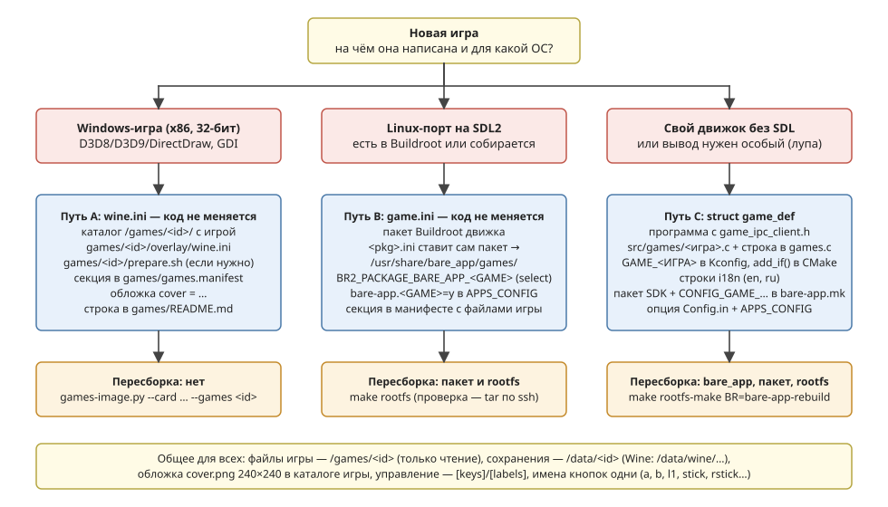
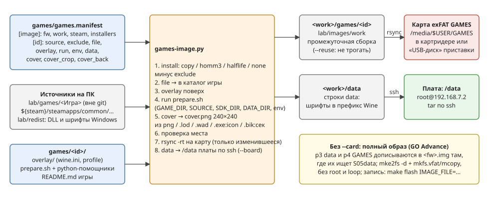

# 5. Добавление новой игры



Сначала ответьте на три вопроса: **на чём написана игра** (путь A/B/C), **где
её файлы на ПК** (`lab/games/<Игра>` или библиотека Steam) и **что она пишет**
(сохранения, настройки — они должны попасть на `/data`). Дальше — по пути.

## Путь A: Windows-игра под Wine (GO Ultra)

Ничего не собирается. Нужны: каталог игры на карте, `wine.ini`, секция в
манифесте, обложка.

### 1. Положить игру в `lab/`

`lab/games/<Игра>/` — установленная на Windows (или распакованная `innoextract`)
игра как есть. Инсталляторы и переводы остаются в `/media/D/Games/Install`
(`${installers}` в манифесте), игры Steam — в библиотеке Steam (`${steam}`).

### 2. Написать `games/<id>/overlay/wine.ini`

Возьмите за основу ближайшую игру (`games/templar/overlay/wine.ini` — простая
D3D8-игра, `games/pop/overlay/wine.ini` — стики как WASD и мышь,
`games/hota/overlay/wine.ini` — курсор и прокрутка карты) и образец со всеми
ключами `apps/bare_app/ports/wine/wine.ini`. Минимум:

```ini
name = Моя игра
hint = A  клик    B  Esc    F5  свернуть    F6 (держать)  выйти
hint.ru = A  клик    B  Esc    F5  свернуть    F6 (держать)  выйти
exe = Game.exe
mode = 800x600
scale = aspect
locale = ru_RU
writable = Save, config.ini
env = BOX64_DYNAREC_BIGBLOCK=3 BOX64_DYNAREC_CALLRET=1
fps_limit = 30

[keys]
stick = mouse
rstick = wheel
dpad = arrows
cursor_speed = 0.8
a = lbutton
b = esc
x = enter
y = rbutton
f1 = esc

[labels.ru]
stick = курсор
a = клик
```

Что решить на этом шаге:

- **`fps_limit`.** Предел кадров по умолчанию (пользователь меняет его в опциях
  игры, Y на плитке). Смотрите, сколько игра делает в игре и в меню
  (`BARE_APP_SYSMON=frames`): скачет между 30 и 50 — ставьте 30; держит 60 —
  60; меньше 30 не ставьте. Без ключа — без предела.

- **`mode`.** Начните с 800×600: на 854×480 это почти ширина 1:1 при `scale =
  fill` или аккуратные поля при `aspect`. 1024×768 обычно медленнее и мельче.
  Если игра знает только 800×600 и интерфейс внизу — смотрите `rows` и
  пример Neighbours from Hell (`games/neighbours/prepare.sh` перекладывает
  интерфейс в верхние 480 строк, сам буфер игры не трогая).
- **`writable`.** Всё, что игра пишет в свой каталог (`Save`, `*.cfg`, профили).
  Проверяется только запуском с `/games` **только для чтения** — так, как у
  пользователя. Карта в режиме `rw` однажды скрыла запись `MSSSOFT.M3D`,
  ломавшую Gothic.
- **Мышь.** Если курсор в меню «ползёт» или клик промахивается — игра читает мышь
  через DirectInput: `mouse = relative`.
- **Шрифты и DLL из Windows.** Если игре нужны `d3dx9_41.dll`, OpenAL из
  `SysWOW64` или шрифты Arial/Palatino — они берутся из `lab/redist/` строками
  `file` (в каталог игры, `dlls = x=n,b`) и `data` (шрифты в префикс на `/data`).

### 3. При необходимости — `games/<id>/prepare.sh`

Запускается `games-image.py` после копирования с переменными `GAME_DIR`,
`SOURCE`, `SDK_DIR`, `DATA_DIR` и `env` из манифеста. Правит файлы игры под
приставку: разрешение в её настройках (HotA), русификация дельтами (PoP),
перекладка интерфейса (Neighbours), сборка лаунчера `poplaunch.exe`
кросс-компилятором `llvm-mingw` из `output/ogu/buildroot/host`. Скрипт должен
быть идемпотентным: `rsync` переносит на карту только изменившиеся файлы, и
повторный запуск не должен переписывать всё заново (`touch -r` оригинала у PoP —
именно для этого).

### 4. Секция в `games/games.manifest`

```ini
[mygame]
; Моя игра (2004), русское издание 1С, Wine. Что исключено и почему
source = lab/games/MyGame
exclude = unins000.*
exclude = *.url
exclude = Manual.pdf
file = lab/redist/SysWOW64/D3DX9_41.dll
overlay = games/mygame/overlay
run = games/mygame/prepare.sh
env = SOMETHING=${installers}/MyGame/patch.exe
data = lab/redist/Fonts/arial*.ttf -> wine/prefix/drive_c/windows/Fonts/
cover = lab/games/MyGame/Game.exe:icon
cover_crop = fit
```

Ключи — [games/README.md](../../games/README.md). Пути без `/` — от корня SDK;
`${steam}`, `${installers}` — из `[image]`. Исключайте деинсталляторы, логи,
остатки GOG, `*.lnk`, сохранения с ПК и дубли (RTCW: только нужные `pk3`, 0,95 ГБ
вместо всего).

### 5. Залить и проверить

```sh
scripts/games-image.py --card /media/$USER/GAMES --reuse --games mygame --board root@192.168.7.2
scripts/ogu-ctl.py launch:mygame wait:30000 shot:/tmp/m.png
scripts/ogu-ctl.py wfmove:400,240 wclick wkey:esc quit-game
```

`--reuse` не пересобирает остальные игры, `--board` кладёт строки `data` на
`/data` по ssh. Карта — в картридере или через экран «USB-диск». Смотрите
`/data/logs/<игра>/1.log` на плате: туда идёт вывод Wine (журнал запуска,
три последних запуска). Первый запуск после
пересборки Wine падает один раз и может сбросить настройки — это известно.

### 6. Записать

Строка в списке игр `games/README.md`, `games/<id>/README.md` с тем, что
пришлось выяснить (у Monkey Island, Templar, PoP такие есть), при необходимости —
абзац в `apps/bare_app/README.md`. Коммит — SDK (`games/`) и, если трогали
мост, `apps/bare_app`.

## Путь B: SDL2-игра

### B1. Движок есть в Buildroot (Chocolate Doom)

Четыре правки, ни одной строки кода:

1. `board/common/buildroot/package/bare-app/games/<игра>.ini` — описание;
2. опция в `package/bare-app/Config.in`:
   ```kconfig
   config BR2_PACKAGE_BARE_APP_CHOCOLATE_DOOM
   	bool "Chocolate Doom (an SDL2 game by its game.ini)"
   	depends on BR2_PACKAGE_BARE_APP_SDL
   	select BR2_PACKAGE_CHOCOLATE_DOOM
   	select BR2_PACKAGE_SDL2_MIXER
   	select BR2_PACKAGE_DOOM1_WAD
   ```
3. строка в `bare-app.mk`: `BARE_APP_GAME_INIS-$(BR2_PACKAGE_BARE_APP_CHOCOLATE_DOOM) += chocolate-doom.ini`;
4. `APPS_CONFIG += bare-app.CHOCOLATE_DOOM=y` в конфиге прошивки.

### B2. Свой пакет движка (DOOM 3 BFG, RTCW, новая игра)

1. Пакет `board/common/buildroot/package/<pkg>/`: `Config.in`, `<pkg>.mk`,
   `<pkg>.hash`, патчи; `source` в `board/common/buildroot/Config.in`. Зависимости
   от Mesa объявлять в самом пакете (`iortcw` когда-то полагался на `bare-app.mk`).
2. Описание — `games/<id>/overlay/game.ini` в SDK, а не в пакете: его кладёт на
   карту вместе с файлами игры `scripts/games-image.py` (`overlay = games/<id>/overlay`
   в секции манифеста). Так пункт меню появляется и пропадает вместе с игрой, а
   исправить описание можно без нового rootfs. Пути в нём — относительно каталога
   игры: `needs = base/data.pak`, `args = --data {dir}`. (Игра, целиком лежащая в
   образе, может ставить `<pkg>.ini` в `/usr/share/bare_app/games/` хуком пакета;
   описание с тем же именем на карте всё равно главнее.)
3. Опция `BR2_PACKAGE_BARE_APP_<GAME>` в `package/bare-app/Config.in` с
   `depends on BR2_PACKAGE_BARE_APP_SDL` и `select BR2_PACKAGE_<PKG>`.
4. `APPS_CONFIG += bare-app.<GAME>=y`, `make rootfs`.
5. Секция в манифесте с файлами игры (`install = none` + `file = … -> main/`,
   как у `[rtcw]`), `overlay` с `game.ini`, `cover` — картинка для `cover.png`.

В `game.ini`: `keys` — для игр без контроллера SDL; `gamepad` — если движок ждёт
другую раскладку (`f1=start, f4=back`); `scale = fit`; `fps = 0`, если движок
сам держит темп; `fps_limit` — предел кадров по умолчанию (как у Windows-игр); `gyro` — для шутеров. В `[env]` можно `SDL_RENDER_DRIVER =
software` (на OGA чтение кадров GPU медленнее, чем программный рендер) и
`SDL_LOGGING = video=debug` для отладки драйвера. **Не ставьте** `SDL_VIDEODRIVER`.

Проверка без перепрошивки:

```sh
T=output/ogu/buildroot/target
tar -C $T -cf - usr/bin/mygame | ssh root@192.168.7.2 'tar -C / -xf -'
tar -C games/mygame/overlay -cf - . | ssh root@192.168.7.2 \
    'mount -o remount,rw /games && tar -C /games/mygame -xf - && mount -o remount,ro /games'
scripts/ogu-ctl.py launch:"My Game" wait:20000 shot:/tmp/s.png
```

Главный экран заметит новую игру сам (каталоги игр проверяются раз в 2 секунды).

### B3. Linux-игра x86_64 под Box64 (UT2004)

Старые Linux-порты (Loki, icculus) — x86/x86_64 на SDL 1.2. Их запускает Box64
(пакет `box64`), SDL 1.2 даёт `sdl12-compat` поверх SDL2 с драйвером `bareapp`,
OpenAL и GL Box64 берёт системные. Нужно:

1. пакет-стартер (как `package/ut2004`): скрипт в `/usr/bin` с HOME в `/data/<id>`,
   `SDL_VIDEO_GL_DRIVER=libEGL.so.1`, `BOX64_PREFER_WRAPPED=1` (игра может звать
   свою `./libSDL-1.2.so.0` — её не ставить), файл OpenAL Soft с устройством из
   `AUDIODEV`; опция `bare-app.<GAME>=y` с `select BR2_PACKAGE_BOX64`,
   `BR2_PACKAGE_SDL12_COMPAT`, `BR2_PACKAGE_OPENAL`;
2. установщик или секция манифеста с файлами игры, `game.ini` в overlay;
3. управление: если у игры есть свой джойстик SDL 1.2 — стики через него (оси
   SDL идут по порядку: левый X/Y, правый X/Y, триггеры), кнопки — клавишами через
   `keys`, а `gamepad = … =none` убирает их из джойстика, чтобы не было двойных
   нажатий.

### B3. Готовая программа на карте, без пакета

```
/games/mygame/
    game.ini        exe = mygame, dir = {dir}, needs = data
    mygame          собрана тулчейном SDK (output/ogu/buildroot/host/bin/aarch64-…-gcc)
    data/
```

Писать в свой каталог программа не сможет: HOME — `/data/mygame`.

## Путь C: игра со своим движком

Кратко; полный пример с кодом — [GAMES.md](../../apps/bare_app/docs/GAMES.md).

**Сторона игры.** Включить `games/game_ipc_client.h` и `core/input.h`
(в Buildroot — `$(STAGING_DIR)/usr/include/bare_app/`, пакет зависит от
`bare-app`). Цикл: `game_link_open()` → `poll` на fd 3 → `game_link_recv()`
кнопки и оси → нарисовать в `game_link_frame()` (размер `app.shm->width ×
height`, строка `stride`) → `game_link_publish()`. Кадры, которые не изменились,
не публиковать (или слать `GAME_FRAME_SAME`). Выход с кодом 0 — нормальный;
`SIGTERM` — закрыть. Предел кадров из опций игры `game_link_publish()` соблюдает
сам; движок со своей публикацией зовёт перед кадром `game_shm_pace()` из
`game_ipc.h`.

**Сторона bare_app** (`apps/bare_app`):

| Где | Что |
|---|---|
| `src/games/mygame.c` | `struct game_def game_mygame` с `missing()` (проверить программу и данные) и `start()` (окружение через `game_vars_add`, `game_proc_start(&spawn)`) |
| `src/games/games.c` | `extern` + `&game_mygame,` под `#ifdef CONFIG_GAME_MYGAME` в порядке меню |
| `Kconfig` | `GAME_MYGAME` с `select GAMES`, `GAME_MYGAME_PROGRAM` и пути данных |
| `CMakeLists.txt` | `add_if(CONFIG_GAME_MYGAME src/games/mygame.c)` |
| `src/gui/view/core/i18n.h`, `i18n.c` | `S_MYGAME`, `S_MYGAME_HINT` на английском и русском |
| `configs/ogu_defconfig`, `oga_defconfig` | `CONFIG_GAME_MYGAME=y` для сборки без Buildroot |
| `src/platforms/*.c` | при необходимости `"mygame.ключ=значение"` в `game_opts` (как `homm3.view=fit`) |

**Сторона SDK:** пакет движка; `CONFIG_GAME_MYGAME=$(call BARE_APP_YN,$(BR2_PACKAGE_BARE_APP_MYGAME))`
в `BARE_APP_KCONFIG` файла `bare-app.mk`; опция в `package/bare-app/Config.in`;
`APPS_CONFIG += bare-app.MYGAME=y`. Пересборка: `make rootfs-make BR=bare-app-rebuild && make`.

На ПК протокол гоняет `ctest` (`game_smoke` с `tests/fake_game.c`); игру можно
запустить в симуляторе `-p pc-mem` с `BARE_APP_NATIVE_DIRS`.

## Манифест и карта: как это работает



`scripts/games-image.py --card` собирает игры в `lab/images/work/games/<id>`
(`install` → `exclude` → `file` → `overlay` → `run` → `cover`), проверяет место и
`rsync -rt` переносит на карту то, что изменилось по размеру или времени.
Каталоги на карте, которых нет в манифесте, не трогаются; `--delete` чистит
лишнее внутри каталога игры. Без `--card` получается **полный образ** для
прошивок с разделом игр на том же диске (GO Advance): p3 и p4 дописываются в
`<fw>.img` там, где их ищет `S05data`, без root и loop-устройств.

Данные игр с ПК для Героев и Half-Life копируют не целиком, а только то, что
читает движок: `install = homm3` и `install = halflife` вызывают
`scripts/homm3-install.sh` (Data, Maps, Mp3 + моды VCMI из `dl/hota`) и
`scripts/halflife-install.sh` (`valve`, `valve_russian`).

## Чек-лист перед коммитом

- [ ] игра запускается из меню с `/games` **только для чтения** и после «холодного» старта (новый префикс Wine, пустой `/data/<id>`)
- [ ] сохранение и загрузка работают, файлы оказались на `/data`
- [ ] F5 сворачивает и возвращает, F6 закрывает, выход через меню игры — код 0
- [ ] `hint.ru` и `[labels.ru]` заполнены, экран «Управление» показывает подписи
- [ ] `cover.png` квадратная и не «мыльная» (240×240 из картинки не меньше)
- [ ] FPS посмотрен монитором (F5 удерживать) и записан в README игры
- [ ] `games/README.md`, манифест, `games/<id>/README.md` обновлены
- [ ] `prepare.sh` идемпотентен, повторный `games-image.py --reuse --games <id>` ничего не переписывает
