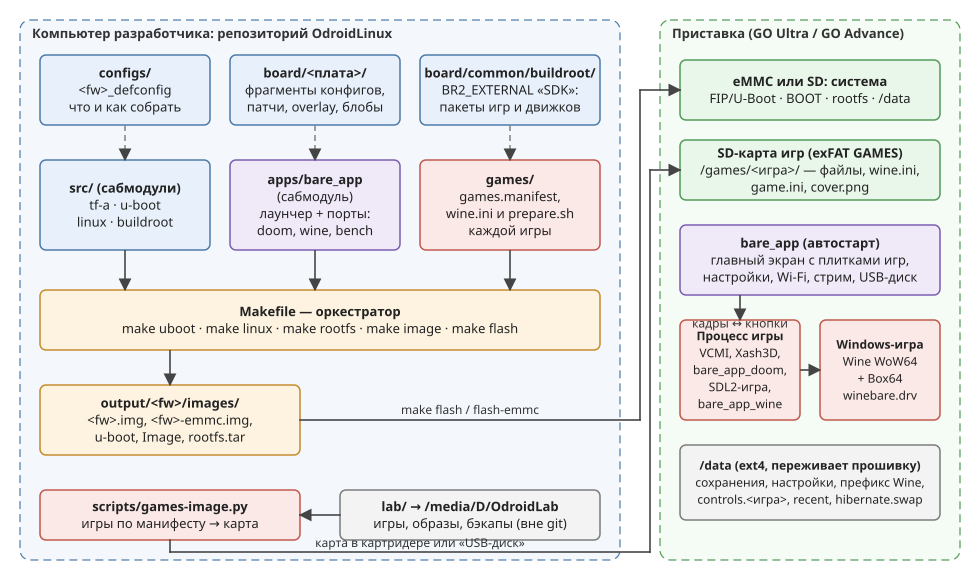
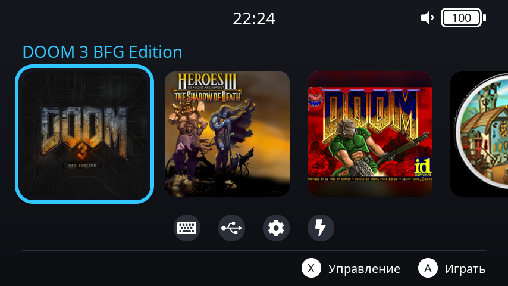

# OdroidLinux — вики проекта

OdroidLinux — это SDK для сборки собственной прошивки портативных приставок
ODROID-GO Advance и ODROID-GO Ultra (а также BeagleBone Black и Raspberry Pi) из
mainline-компонентов: TF-A, U-Boot, Linux, Buildroot. Поверх системы работает
собственный лаунчер **bare_app** (LVGL), который запускает игры: Героев III (VCMI),
Half-Life (Xash3D), Doom, DOOM 3 BFG, Return to Castle Wolfenstein, SDL2-порты и
Windows-игры под Wine (WoW64 + Box64) — все на одной приставке, с геймпада, с
обложками на главном экране, сохранениями на `/data` и играми на карте `GAMES`.




*Главный экран bare_app на ODROID-GO Ultra (снимок `ogu-ctl.py shot`, 854×480).*

## Страницы

| Страница | О чём |
|---|---|
| [1. Устройство SDK](01-SDK.md) | репозиторий, сабмодули, Makefile-оркестратор, конфиг прошивки, патчи, пакеты Buildroot, сборка и перепрошивка |
| [2. Загрузка и разметка дисков](02-Boot-and-Disk.md) | цепочки загрузки плат, разметка SD/eMMC, разделы `/data` и `/games`, карта игр exFAT, USB-диск |
| [3. bare_app — лаунчер](03-bare_app.md) | слои и потоки приложения, главный экран, игры как отдельные процессы, протокол `game_ipc.h`, экран управления, монитор, трансляция |
| [4. Игры: как устроены](04-Games.md) | три пути запуска игр, реестр `game_def`, стек Wine, драйверы SDL2 `bareapp`, движки и их патчи, где что лежит на плате |
| [5. Добавление новой игры](05-Adding-a-Game.md) | пошагово: Windows-игра под Wine, SDL2-игра из пакета, игра со своим движком; манифест и обложки; проверка на приставке |
| [6. Нюансы и подводные камни](06-Pitfalls.md) | всё, на что уже наступали: только чтение `/games`, exFAT, префикс Wine, патчи и `-dirclean`, память при сборке, DirectInput и мышь, шрифты |
| [7. Инструменты](07-Tools.md) | `games-image.py`, `ogu-ctl.py`, `oga-serial.py`, `doom3-test.py`, симулятор на ПК, снимки экрана |
| [8. Платы](08-Boards.md) | особенности GO Advance, GO Ultra, BBB, RPi: консоль, прошивка eMMC, быстрая загрузка, гибернация, часы, питание |

## С чего начать

```sh
sudo apt install mtools gcc-aarch64-linux-gnu gcc-arm-linux-gnueabihf
git submodule update --init --recursive
make ogu_defconfig          # или oga_defconfig
make                        # TF-A/U-Boot + ядро + rootfs + образ, по очереди
make info                   # какая прошивка выбрана, пути, версии
make flash DEV=/dev/sdX     # SD-карта; GO Ultra с eMMC: make flash-emmc (Vol+ при включении)
```

Первая сборка занимает часы (тулчейн, ядро, VCMI, Wine) и около 21 ГБ в `output/`.
Игры в образ не входят: их раскладывает по карте `scripts/games-image.py` по
манифесту `games/games.manifest` (см. [страницу 5](05-Adding-a-Game.md)).

## Где лежат подробности

Эта вики — карта проекта и объяснение «почему так». Точные справочники остаются
в репозитории и в вики на них есть ссылки:

- [docs/config.md](../config.md) — все переменные конфига прошивки;
- [docs/sd-layout.md](../sd-layout.md) — разметка карты до сектора;
- [docs/patches.md](../patches.md) — где лежат патчи и что пересобирается;
- [docs/adding-a-game.md](../adding-a-game.md) и
  [apps/bare_app/docs/GAMES.md](../../apps/bare_app/docs/GAMES.md) — добавление игры с примерами кода;
- [apps/bare_app/docs/ARCHITECTURE.md](../../apps/bare_app/docs/ARCHITECTURE.md) — архитектура лаунчера до уровня файлов;
- [apps/bare_app/README.md](../../apps/bare_app/README.md) — что умеет лаунчер, кнопки каждой игры;
- [games/README.md](../../games/README.md) — манифест и список игр;
- [docs/boards/](../boards/) — страницы плат;
- книги `docs/book`, `docs/dev-book`, `docs/check-book` — как устроен SDK, разработка на нём, проверка плат.

Картинки вики лежат в `docs/wiki/img/`: схемы рисует скрипт
`docs/wiki/img/mkdiagrams.py` (чистый Python, без библиотек), снимки экрана
приставки в `img/shots/` сняты `scripts/ogu-ctl.py shot:`. Менять схему —
значит править скрипт и запускать заново.

**HTML-версия**: `python3 docs/wiki/build-html.py` собирает те же страницы в
`docs/wiki/html/` (открывать `index.html`; каталог самодостаточен — картинки и
стиль внутри, ссылки на файлы репозитория ведут относительно него).
